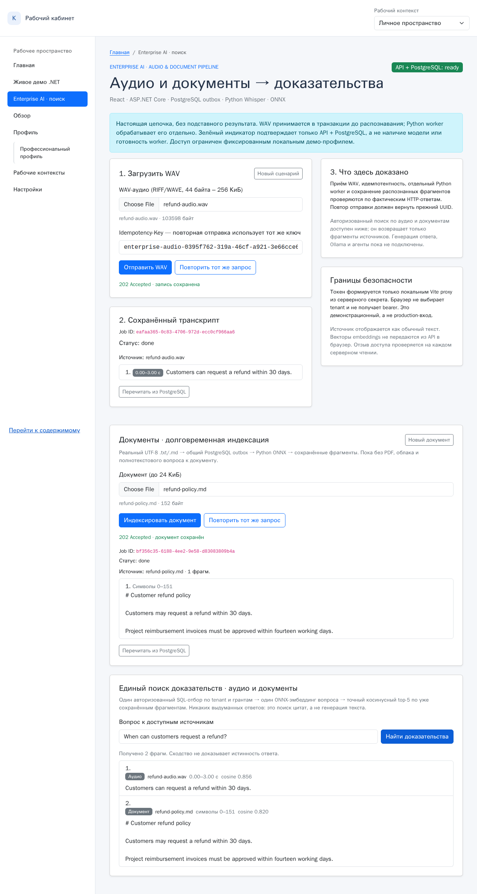

# Engineering portfolio: .NET reliability, RAG/retrieval and full-stack demos

**For .NET / Tech Lead hiring:** start with [Reliable Jobs](dotnet-outbox/README.md) — an ASP.NET Core and PostgreSQL example of transactional outbox, HTTP idempotency, concurrent worker claims, retries and recovery. [Inspect the API transaction](dotnet-outbox/src/Program.cs), [worker](dotnet-outbox/src/OutboxWorker.cs), and [tests](dotnet-outbox/tests).

**For AI / RAG hiring:** start with [audio search + reranking](python-ai/audio-search/README.md) and [retrieval benchmarks](python-ai/rag-docs/README.md). Code and reproducible small-sample evaluations are linked below.

**For full-stack / product hiring:** explore the [React dashboard](bootstrap5/README.md) and [GosVet veterinary-clinic prototype](GosVet/README.md).

These project folders contain **original engineering examples, not claims of commercial deployments**. The integrated Enterprise AI demonstration below explicitly reuses several of their real services; remaining examples have their own runbooks. Commercial X5 and CASESTUDIO experience is described in the resume rather than inferred from this code.

## Working Enterprise AI Platform — one user journey

**Start with the real browser demonstration:** [**WAV + document → one authorized semantic evidence search**](enterprise-demo/EVIDENCE-2026-11-09-SEARCH.md) · [**Watch real Chromium MP4**](enterprise-demo/media/enterprise-search-real.mp4) · [**Inspect the exact screenshots**](enterprise-demo/media/enterprise-search-real.png).

[](enterprise-demo/EVIDENCE-2026-11-09-SEARCH.md)

In this single localhost-only journey, a WAV is transcribed by **Whisper** and a Markdown document is indexed by **BGE-small ONNX**; both persist through the **same .NET/PostgreSQL outbox and Python worker**. A signed demo user asks one question; **PostgreSQL applies current tenant and explicit read grants before returning segments**, then one local encoder ranks the two sources and the browser shows exact source/time/character citations. Revoking either grant removes it on the next search. A user with no authorized evidence receives **no invented answer**. See the [reproducible 2026-11-09 acceptance and hard limits](enterprise-demo/EVIDENCE-2026-11-09-SEARCH.md).

This is a **bounded synthetic engineering demonstration**, **not** a commercial deployment: fixed localhost identity, no production OIDC/RLS, no multi-user login, no PDF/OCR, no LLM-generated answers, no real-world relevance benchmark, and a previously observed .NET out-of-memory under prolonged high RDC load remains unresolved. Architecture decisions and verification evidence are available in the source and CI.

## Enterprise AI Platform integration roadmap

**Architecture and next milestones:** [Enterprise AI Platform implementation plan](architecture/ENTERPRISE-AI-PLATFORM-PLAN.md) tracks EP-00–EP-09, acceptance and security gates. **EP-02/03/04 have real, bounded browser/DB/model evidence; EP-05 answer synthesis and later hardening remain planned.** This is an integrated *local hiring demo*, not a commercial production deployment.

**First implementation increment (EP-01/EP-02):** [Enterprise WAV-to-transcript browser demo](enterprise-demo/README.md) adds a separate `/dashboard/enterprise-ai` route, localhost-only trusted demo proxy, real audio-job HTTP client and Python-worker launcher. **Now independently exercised on 2026-11-08 against a real disposable PostgreSQL, local Whisper/ONNX and Chromium**: [actual screenshot, playable video, repeatable test, exact evidence and limitations](enterprise-demo/EVIDENCE-2026-11-08.md). These synthetic, bounded runs are **not** production readiness; prolonged RDC operation later hit an API memory-allocation failure, recorded in the evidence. The original two-minute text-job Hiring Demo remains a separate, CI-backed interview route.

**New: EP-03 durable document ingestion (9 Nov 2026).** The same page now also accepts bounded real UTF-8 `.md/.txt` files, persists them atomically in PostgreSQL, indexes chunks with the existing Python ONNX worker, and proves idempotent retry, wrong-tenant/revoked denial and **server-side exclusion of embedding vectors**. [Real Chromium demo, screenshot and verification report](enterprise-demo/EVIDENCE-2026-11-09.md). EP-04 **unified authorized retrieval** is now demonstrated on both source types ([real browser evidence](enterprise-demo/EVIDENCE-2026-11-09-SEARCH.md)); EP-05 grounded answer synthesis is still planned, not implemented.

## Two-minute live interview demo

**Start here for Tech Lead / Solution Architect interviews:** [Hiring Demo walkthrough](hiring-demo/README.md). The existing [React dashboard](bootstrap5/src/pages/HiringDemoPage.tsx) now has a live `/dashboard/hiring-demo` route linked to the actual .NET/PostgreSQL text-job API. The [launcher](hiring-demo/run.py) starts both localhost services after validating database readiness and supports a real API process restart via terminal command `r`.

The browser shows genuine `202 Accepted`, persisted job status, idempotent `200 already-accepted`, `409 Conflict`, and API outage/recovery. **No mock data is used in normal operation.** A separately labeled browser test uses stubbed HTTP to validate the frontend contract; it does not replace the live PostgreSQL smoke. A real **1280×800, ~42-second** PostgreSQL-backed Chromium screencast was captured and verified by [GitHub Actions E2E](https://github.com/Sergey303/demo/actions/runs/42452435834) (all jobs passed). The [recording artifact](https://github.com/Sergey303/demo/actions/runs/42452435834/artifacts/13606193230) is available for 14 days; see the repeatable two-minute manual interview walkthrough in the runbook.

## Strongest code evidence

Follow the implementation and repeatable checks rather than relying on claims.

| Project | What the source demonstrates | Reproduce / inspect | Evidence and limitations |
| --- | --- | --- | --- |
| **[Reliable Jobs — .NET/PostgreSQL](dotnet-outbox/README.md)** | Atomic outbox, idempotent HTTP submissions, `SKIP LOCKED` worker claims, retries and recovery | [HTTP transaction](dotnet-outbox/src/Program.cs) · [Worker](dotnet-outbox/src/OutboxWorker.cs) · [Database schema](dotnet-outbox/sql/001_init.sql) · [Tests](dotnet-outbox/tests) | Local PostgreSQL integration tests and concurrent HTTP smoke passed; [reproducible load probe](dotnet-outbox/tests/benchmark.py). External side effects are **not** exactly-once. |
| **[Audio semantic search + reranking](python-ai/audio-search/README.md)** | Local Whisper speech recognition, ONNX embeddings, exact retrieval, timestamped evidence, optional cross-encoder reranking | [Pipeline](python-ai/audio-search/pipeline.py) · [Retrieval](python-ai/audio-search/search.py) · [Reranking](python-ai/audio-search/rerank.py) · [Holdout experiment](python-ai/audio-search/evaluate_holdout.py) | On 12 **synthetic** holdout questions: top-1 **7/12 → 9/12** with reranking; median query latency **9.9 → 132.6 ms**. Small authored evaluation; not real-world accuracy. |
| **[Neural retrieval and vector-index trade-offs](python-ai/rag-docs/README.md)** | Batched cosine ranking, lexical baseline, exact vs HNSW and recall/latency measurement | [Index implementation](python-ai/rag-docs/app/core.py) · [HNSW benchmark](python-ai/rag-docs/benchmark_index.py) · [Real document embedding evaluation](python-ai/rag-docs/benchmark_real.py) | Synthetic HNSW experiments quantify speed/recall trade-off; tiny document labels are illustrative, not a general relevance benchmark. |

**Local LLM capture:** [reproducible, loopback-only Ollama recording](python-ai/rag-docs/BLIND-EVAL.md) ties raw generations to sealed evaluation cases; now verified against local Ollama/Qwen3 1.7B on RDC for one synthetic case; independent human review is still unavailable.

**AI quality evidence:** [RAG refusal, source-grounding and failure analysis](python-ai/rag-docs/QUALITY-EVAL.md) — an executable score gate with a deliberately non-passing real-model result. [Independent blind annotation and free-form answer review](python-ai/rag-docs/BLIND-EVAL.md) adds a sealed evaluation workflow, with **no independent labels or measured LLM answers yet**.

**Security engineering:** [tenant-scoped audio retrieval](architecture/AUDIO-ACCESS.md) and [document RAG access](python-ai/rag-docs/README.md) — signed identity, owner grants, fail-closed search and HTTP result reads (PostgreSQL ACL integration and full model-backed E2E verified on 2026-11-07); separate from production OIDC/RLS.

**Runnable integration increment:** [durable WAV ingestion and AI worker](architecture/DURABLE-AUDIO.md) accepts media before Whisper inference, with explicit migration and test instructions. Live E2E proof is separately gated.

**Architecture case (System / AI Architect):** [Enterprise Knowledge & Meeting Evidence Platform](architecture/README.md) — C4 target architecture, 3 evidence-backed ADRs, failure/trust matrix, [cross-project audio→Outbox→search orchestration](architecture/evidence_flow.py) (ASR pre-acceptance), and an [executable retrieval quality/latency gate](architecture/decision_gate.py). Implemented components and unbuilt integrations are clearly separated.

**Read first:** [`AGENTS.md`](AGENTS.md) gives automated reviewers the code paths, invariants, checks and honest evidence boundaries. Each example is self-contained; model weights, hardware and optional services are described in its own README.

## Frontend examples

### Bootstrap 5 Dashboard Shell

React, TypeScript, Vite and Bootstrap 5. Responsive dashboard with six routes, workspace switching, editable profile and Playwright tests.

- [Source and detailed instructions](bootstrap5/README.md)
- [Desktop preview](bootstrap5/docs/media/desktop-demo.gif)
- [Mobile preview](bootstrap5/docs/media/mobile-demo.gif)

```bash
cd bootstrap5
npm ci
npm run dev
```

### GosVet

Veterinary-clinic demo, React and PrimeReact, with single-file build. Copied from the original [GosVet](https://github.com/Sergey303/GosVet) repository into [GosVet/](GosVet/) as regular versioned files. This directory is **not** a Git submodule.

```bash
cd GosVet
npm ci
npm run dev
npm run build
```

See [GosVet/README.md](GosVet/README.md) for application routes and its portable `dist/index.html` build.

## Additional Python AI examples

- [Neural RAG document assistant](python-ai/rag-docs/README.md): multilingual neural embeddings, semantic search, source references and optional local Ollama generation.
- [PyTorch ticket classifier](python-ai/ticket-classifier/README.md): train an embedding + MLP neural network, evaluate on held-out toy samples and serve inference through FastAPI.

- [Safe tool-calling agent](python-ai/tool-agent/README.md): restricted tools, validation and approval gate (deterministic groundwork for an LLM planner).

See [Python AI portfolio overview](python-ai/README.md). Python dependencies and tests are isolated per example.

## Layout

```text
demo/
  bootstrap5/     # Bootstrap 5 dashboard
  GosVet/         # Veterinary clinic application
  dotnet-outbox/  # ASP.NET Core, PostgreSQL and tests
  python-ai/     # Audio search, Neural RAG, classification and tool agent
  README.md
```

All projects are standalone. Run npm commands in the corresponding project directory rather than the repository root. The original GosVet repository is kept unchanged. Note that all committed files under `demo/GosVet/` are public because this repository is public.

**Local generative RAG evaluation:** [two genuine Qwen3 runs on 11 synthetic tenant-scoped cases](python-ai/rag-docs/SYNTHETIC-QWEN3-CAPTURE.md), including exposed failures of citation formatting, a fixed thinking-token truncation defect, and reproducible mechanical diagnostics. Not an independent answer-quality benchmark.

**Grounded-answer safety boundary:** [guarded opt-in free-form RAG](python-ai/rag-docs/README.md) checks current source permissions and strict model citation/JSON output, abstaining on invalid/unsupported-format output; real local Qwen3 smoke tested. Citation validity is not proof of semantic support.

**Claim-level provenance:** [opt-in exact-copy `claim_checked` RAG](python-ai/rag-docs/README.md) derives each claim from a complete sentence in a tenant-authorized source, with atomic rejection if any source span is invalid. This is NOT semantic entailment or independent evidence of accuracy.
