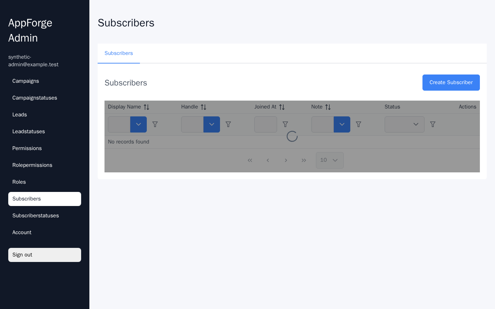
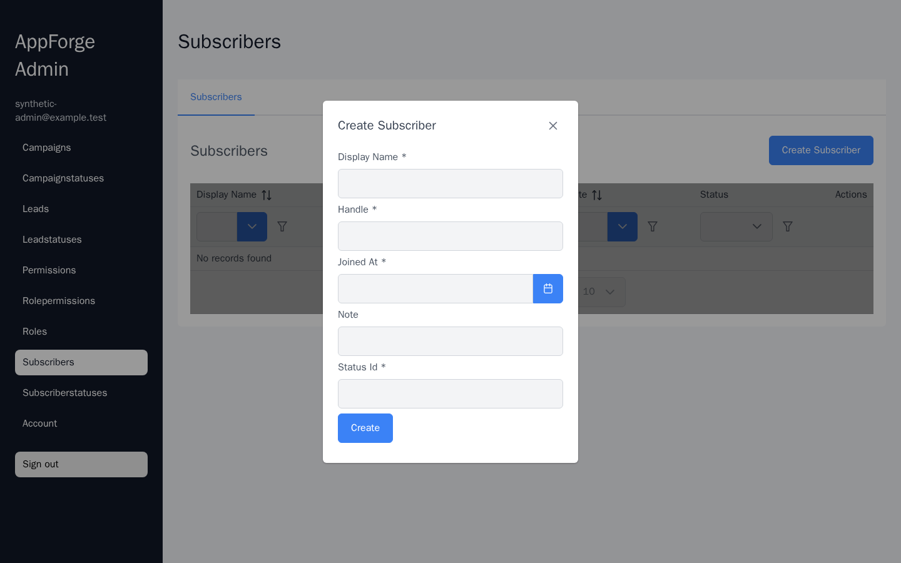

# Generic CRUD Backoffice — generated by AppForge

**Purpose:** show how a typical admin panel can be built from a **95-line Markdown
subject model** without hand-writing the CRUD layers. The *historical sample model*
was named `Telegram Operations Admin`, with `Subscriber`, `Lead` and `Campaign`
entities, but it contains **no Telegram integration or bot logic**. The relevant
capability is domain-independent generation of forms, tables, ASP.NET Core APIs,
EF Core persistence, migration SQL and typed clients. This is a **standalone,
synthetic portfolio exercise**, not a customer order or production deployment.

**Generator:** private [Sergey303/AppForge](https://github.com/Sergey303/AppForge),
published `main` at `42b21c0689e235b19ce8e607cedfa40321fe864a`.
The generator is a separate reusable engineering tool; this public repository
contains the **input model, generated output and verifiable build instructions**,
not a copy of the private generator.

## The Pareto boundary

The full AppForge generation supplies:

- **Domain and storage:** `Subscriber`, `Lead` (linked to `Subscriber`), and
  `Campaign`; their state dictionaries, keys and indexes; EF Core migrations;
  PostgreSQL-oriented backend and idempotent migration SQL.
- **API and contracts:** typed ASP.NET Core CRUD/list/filter/sort endpoints,
  authorization policies, canonical JSON backend contract, TypeScript API
  actions/hooks and a generated HTTP client.
- **Admin interface:** authenticated React/Vite/PrimeReact shell, page navigation,
  tabular lists with server-side paging/filtering/sorting, create/edit/details/
  delete surfaces, and domain-specific forms.
- **Operational starting point:** generated auth, environment templates and
  Docker/Compose deployment **configuration**. The configuration has not been
  validated as a production deployment.

### Explicitly **not** implemented

- Telegram Bot API integration, chat sessions, webhooks, message sending or
  broadcasts. `Campaign` means **stored draft/approval metadata**, not actual
  outbound delivery.
- Billing, recurring payments, subscription entitlements or payment callbacks.
- Actual lead intake from Telegram, scheduled jobs, outbox delivery, queues or
  analytics/KPI dashboards.
- Product-specific state-transition rules, multi-tenant isolation, production
  OAuth/OIDC, data retention and human approval workflows.
- Live PostgreSQL/browser E2E, load testing, production security assessment or
  operating the generated Docker Compose stack. Generated auth and admin-only
  policies are a starting point, not a completed product security model.

**Honest 80/20 claim:** a repeatable model-to-stack generation pass covers
CRUD/storage/API/typed-client/UI scaffolding, **not** 80% of an arbitrary project's
complexity, risk, effort or business logic.

## Inspect in 60 seconds

| Layer | Where to look |
|---|---|
| Only hand-authored domain specification | [telegram-operations.md](telegram-operations.md) |
| Data types, FKs, generated migrations | [EF domain](generated/backend/Domain/), [migration SQL](generated/backend/Migrations/AppForgeGeneratedMigrations.idempotent.sql) |
| API controllers and authorization | [backend Api](generated/backend/Api/), [Program](generated/backend/Program.cs) |
| Canonical machine-readable contract | [subscribers](generated/backend-contract/subscribers/endpoints.json), [leads](generated/backend-contract/leads/endpoints.json), [campaigns](generated/backend-contract/campaigns/endpoints.json) |
| Generated frontend CRUD pages | [subscribers](generated/frontend-app/src/generated-ts/subscribers/pages/SubscribersPage.generated.tsx), [leads](generated/frontend-app/src/generated-ts/leads/pages/LeadsPage.generated.tsx), [campaigns](generated/frontend-app/src/generated-ts/campaigns/pages/CampaignsPage.generated.tsx) |
| Routing and login shell | [App](generated/frontend-app/src/App.tsx), [generatedPages](generated/frontend-app/src/generatedPages.tsx), [Login](generated/frontend-app/src/auth/LoginPage.tsx) |
| Deploy starting point | [Compose](generated/deploy/production/docker-compose.production.yml), [runbook](generated/deploy/production/RUNBOOK.md) |

All files in `generated/` originate from AppForge. The separately authored
`Directory.Build.targets` is a **security compatibility override**, not hand-written
CRUD/business code. The generated frontend includes a second copy of the typed
TypeScript output under `src/generated-ts/` because the standalone Vite bundle
needs to resolve its own imports.

## Generated UI — synthetic browser capture

These images show **only the generated React UI** served from the Vite build.
Playwright intercepts the authentication/API requests; neither a running
PostgreSQL backend nor Telegram is involved.

[](evidence/generated-admin-shell-mocked.png)

[](evidence/generated-admin-create-form-mocked.png)

UI-only capture source:
[evidence/capture-synthetic.cjs](evidence/capture-synthetic.cjs).
With the generated `dist/`, Chromium and Playwright available, run
`node evidence/capture-synthetic.cjs` from the `appforge-admin` directory;
use `CDP_ENDPOINT` to attach to an existing permitted browser if launching
Chromium is unavailable. **Screenshots are illustrative, not E2E proof.**

## Reproduce

Prerequisites: .NET SDK 10, PowerShell 7, Python 3, Node.js/npm, working
NuGet/npm package registries, and access to the private AppForge checkout.

```bash
git clone https://github.com/Sergey303/demo.git
git clone https://github.com/Sergey303/AppForge.git
cd demo
APPFORGE_ROOT=../AppForge ./appforge-admin/generate.sh
```

`generate.sh` runs AppForge's existing **production-package** pipeline with
this model and its own `-Clean` option. It regenerates `generated/`; **do not
manually edit generated files**. Build artifacts (`bin`, `obj`, `node_modules`,
`dist`) are intentionally excluded from Git, but recreated by generation.
For a Windows host, invoke
`AppForge/scripts/quality/run-md-ef-core-production-package.ps1` directly
with `-SpecPath` and `-OutputRoot` pointing to this folder.

For a narrow source check after generation:

```bash
dotnet build appforge-admin/generated/backend/TelegramOperationsAdmin.Persistence.csproj --no-restore -warnaserror
python3 appforge-admin/verify_contracts.py
```

### Reproducibility and evidence (9 Nov 2026)

- AppForge source: `42b21c0689e235b19ce8e607cedfa40321fe864a`.
- Generated model: **3 business entities** plus **6 generated lookup/auth entities**
  in the entity-generation report; actual migration includes authentication and
  infrastructure tables beyond those 9 entities.
- Clean full generator pass on the authorized RDC environment:
  **277 seconds**, measured including EF generation, migrations, canonical
  backend contract, TypeScript, React production bundling, and first npm
  installation. This is **one measured local run**, not a performance benchmark.
- .NET generated backend build: **0 warnings, 0 errors**.
- React production bundle: Vite build succeeded; emitted lazy route chunks.
- Browser UI-only capture passed with mocked authentication and API responses;
  see screenshots above. This is **not** proof of live PostgreSQL or Telegram.

**Dependency security compatibility:** unmodified AppForge at this revision
resolved `System.Security.Cryptography.Pkcs 9.0.0` via its .NET design-time
dependency, failing NuGet security auditing with
[GHSA-846f-f764-76mx](https://github.com/advisories/GHSA-846f-f764-76mx)
and [GHSA-2fmv-rv2c-59x7](https://github.com/advisories/GHSA-2fmv-rv2c-59x7).
The scoped [Directory.Build.targets](Directory.Build.targets) adds the patched
`10.0.13` package for this generated backend. The patch is committed in
the **consumer** so regeneration remains safe without changing generated code.

The [generated manifest](generated/manifest/package-manifest.json) is raw
AppForge output: its absolute `/workspace/...` paths and generation timestamp
record the **original generation environment**. Use relative paths in this
README to rebuild elsewhere.
