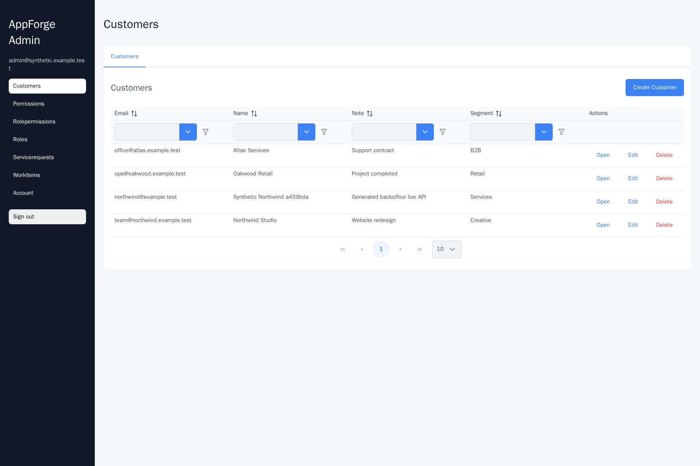
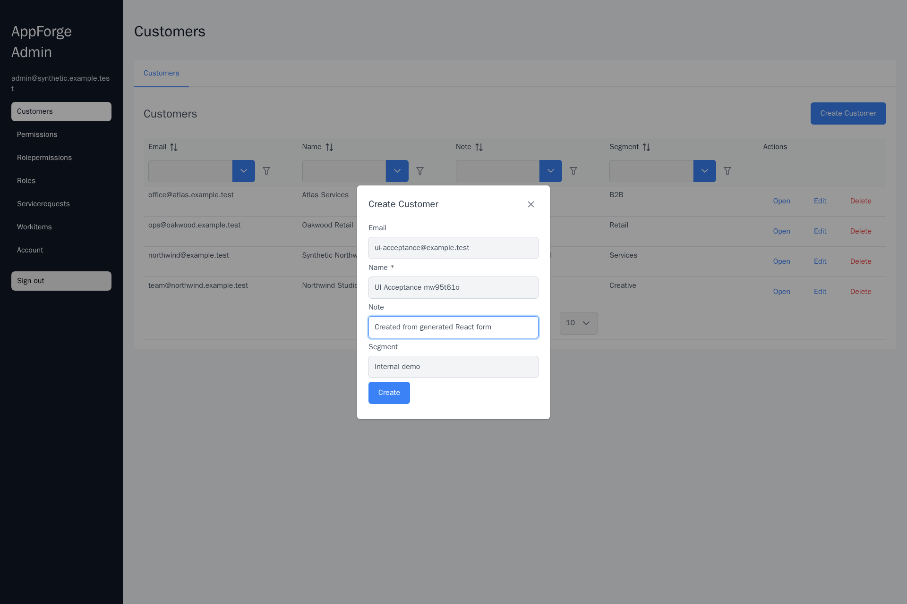
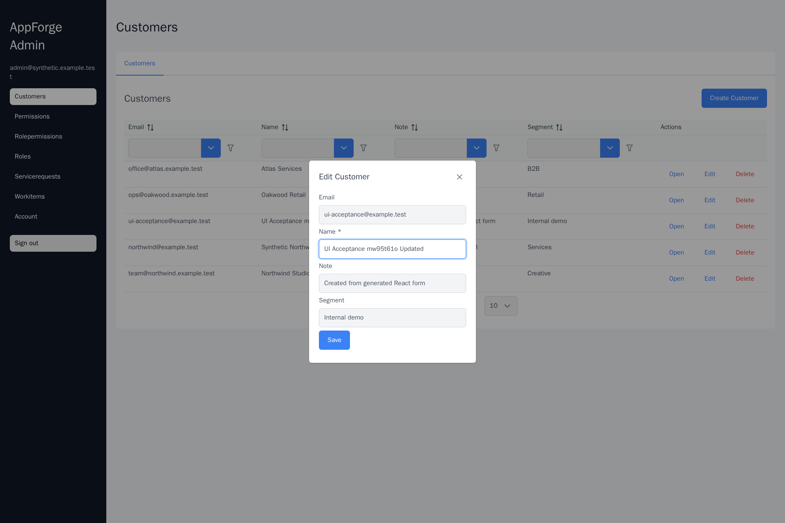

# Business Operations Admin — AppForge-generated CRUD

**Goal:** show a reusable way to generate the bulk of a typical administrative
application from a compact domain model, not hand-write repetitive CRUD for every
order. This sample is **domain-neutral**: customers, service requests and work
items. It is not connected to Telegram, a CRM provider, an email service or a
commercial customer.

> For an employer/code-review agent: start with the [95-line input model](business-operations.md),
> then compare the [generated API](generated/backend/Api/Controllers/CustomerController.cs),
> [EF model](generated/backend/Persistence/BusinessOperationsAdminDbContext.cs),
> [canonical contract](generated/backend-contract/customers/endpoints.json),
> and [generated UI](generated/frontend-app/src/generated-ts/customers/pages/CustomersPage.generated.tsx).
> The generator itself is in a separate private
> [AppForge repository](https://github.com/Sergey303/AppForge).

## The generated 80/20 baseline

| Input / layer | What AppForge produced |
| --- | --- |
| [Domain model](business-operations.md) | Customer → ServiceRequest → WorkItem relations, constraints and indexes; admin-only policies; plain editable customer fields |
| .NET 10 / EF Core 10 | ASP.NET Core CRUD, EF entities/DbContext, explicit migration chain and idempotent PostgreSQL SQL |
| API contracts | Canonical JSON contracts + TypeScript DTOs, operations, HTTP client and React Query hooks |
| React / PrimeReact | Admin navigation, login/account screens, CRUD forms and tables, pagination, filtering/sorting, create/edit/delete controls |
| Delivery contour | Vite production build and an unexecuted Compose production preset |

The generated frontend bundles a second copy of the generated TypeScript API
under `frontend-app/src/generated-ts` for Vite module resolution. This
intentional duplication is generator output, not a handwritten fork.

### Deliberate omissions

No complex lookup selectors/related-entity editors, custom validation or customer-specific workflows, CRM connectors, file upload, billing,
notifications, scheduled jobs, dashboards/analytics, tenant isolation,
production OIDC, security audit, accessibility assessment, load tests or live
deployment. The generic generated authentication/authorization is a starting
point: business-specific permission and role review is needed before
production. No external service integrations are claimed.

The **Pareto claim** is that generation covers much of the *standard
scaffolding*, **not** that 80% of all engineering effort or risk is solved.
Generated source is included for inspection; the code generator is private.

## Verified execution and screenshots

The complete model-to-stack generation succeeded on 9 November 2026 in **245
seconds** (one measured RDC run including NuGet/npm dependencies and frontend
build, not a statistical benchmark). The generated .NET backend built with
**0 warnings and 0 errors** and the Vite production bundle built successfully.

**Real disposable PostgreSQL + ASP.NET Core API + Chromium passed:**

- [10 API/SQL assertions](evidence/CRUD-API-EVIDENCE.json): admin login,
  required password rotation, reject unauthenticated call, create/read/list/
  update/delete, idempotent create replay, and SQL checks.
- [12 live Chromium API interactions](evidence/CRUD-LIVE-EVIDENCE.json):
  login, render real rows, create/edit/delete using generated React forms,
  plus direct SQL checks and HTTP 404 after soft-delete.
- [Browser test source](evidence/crud_browser_live.cjs),
  [API test source](evidence/crud_api_live.py), and
  [synthetic gallery creator](evidence/seed_live_gallery.py).
  Playwright uses a **local HTTP reverse-proxy route** for same-origin browser
  requests; all requests reach the genuine generated API, **not mock responses**.
  A temporary test-only admin account and synthetic customers are used.

### Actual generated UI captures (real database, no mocked API)

[](evidence/business-admin-customers-live.png)

[](evidence/business-admin-create-live.png)

[](evidence/business-admin-edit-live.png)

These are local browser captures at 1920 × 1280, not screenshots of a
deployed production service. The generated delete operation uses **soft delete**
(`IsDeleted=true` in SQL and 404 on subsequent GET); it is not a physical
PostgreSQL row removal. The generated backend denies unauthenticated list
access with 403 in the tested configuration.

**Generator provenance:** [AppForge commit d95eff72](https://github.com/Sergey303/AppForge/commit/d95eff72e62347d12abddeea91ab27aef5d36d45).
During this work, a GET query-normalization bug was found and fixed in the
generator (it previously unwrapped a complex `request` query parameter
before transport binding); six focused template regression checks passed and
this final Chromium CRUD was run on regenerated source.

### Reproducibility caveat

The [AppForge manifest](generated/manifest/package-manifest.json) records the
generated model and build-machine paths. The credentials and database used
for the acceptance were local and disposable. To rerun live acceptance, create
a disposable PostgreSQL 17 database, apply the
[idempotent SQL migration](generated/backend/Migrations/AppForgeGeneratedMigrations.idempotent.sql),
seed an admin via `--appforge-seed-only`, configure the generated API's
required CORS/forwarded headers/email placeholders for localhost-only
testing, run `crud_api_live.py`, then `seed_live_gallery.py` and
`crud_browser_live.cjs`. The scripts require explicit local environment
variables and must **never** be run against production/customer databases.

Only the **Customer** browser CRUD path has live acceptance; related
ServiceRequest and WorkItem screens are generated, built and source-checked,
not individually browser-accepted. Docker Compose production deploy, load,
security, accessibility and all customer workflows remain out of scope.

### Run generation

Requires .NET 10 SDK, PowerShell 7, Python 3, Node/npm and access to the
private AppForge checkout.

```bash
git clone https://github.com/Sergey303/demo.git
git clone https://github.com/Sergey303/AppForge.git
cd demo
APPFORGE_ROOT=../AppForge ./appforge-admin/generate.sh
python3 appforge-admin/verify_contracts.py
dotnet build appforge-admin/generated/backend/BusinessOperationsAdmin.Persistence.csproj --no-restore -warnaserror
```

`generate.sh` replaces the generated package while preserving AppForge's
supported migration-continuity behavior for subsequent compatible changes.
For incompatible subject identities, generate to a new empty output root.
Do **not** manually edit files below `generated/`. The production runner
builds a Vite `dist` bundle; `bin`, `obj`, `node_modules`, `dist` and
other transient build artifacts are excluded from Git.

**NuGet advisory compatibility:** an earlier version of the generator
resolved a vulnerable transitive `System.Security.Cryptography.Pkcs 9.0.0`
package at build time. The consumer-scoped
[Directory.Build.targets](Directory.Build.targets) selects patched `10.0.13`
without changing AppForge-generated files. Do not claim it resolves all other
software-supply-chain risks.

The raw AppForge package manifest and generated runbook include build-machine
absolute paths for traceability; always use these repository-relative paths
rather than assuming another developer has the same workspace.
