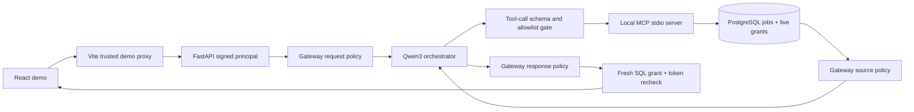

# AI Gateway + authorized MCP orchestrator

**Scope:** local enterprise portfolio only. Branch `feature/ep10-ai-gateway` extends
[EP-09 MCP agent](mcp_agent_host.py) without introducing another datastore,
identity provider, tool runtime, or retrieval index.

## Trust boundaries



**Authorization is not a prompt.** The browser cannot choose tenant, subject,
DB credentials, an Ollama endpoint, or the tool catalog. A trusted server-side
proxy issues a short-lived signed demo principal. The MCP subprocess gets
the same identity via host-controlled environment variables; it verifies it
again. The PostgreSQL query filters jobs by live `tenant_id` and
`audio_read_grants.subject_id` **before any source text or vector enters Python**.
The model receives only bounded citations selected by that query; it cannot
call a generic SQL, shell, network, or file tool.

**Model-led orchestration, bounded execution:** Qwen3 makes a real Ollama
`/api/chat` tool call for `search_evidence`, and then either formats a
strict citation-bearing answer or asks for a `propose_review_note`. One
tool is allowed at each step. The latter **only creates an approval request**;
a human must confirm separately, at which point every origin source grant
is checked again under PostgreSQL locks. This is not a general-purpose
autonomous agent. Historical EP-09 implementation/evidence is in
[the MCP record](../enterprise-demo/EVIDENCE-2026-11-09-MCP.md).

## Gate policy, in execution order

| Check | Enforcement | Failure behavior |
| --- | --- | --- |
| Identity | Signed tenant + subject verified before model; PostgreSQL live grants in tool | 401 or no evidence; model never selects tenant |
| Request | Unicode/control, 500-char limit, high-confidence credential and direct override signals | HTTP 422 before retrieval / model |
| Tool | Exact allowlist + JSON schema, no tenant/token/URL/DSN parameters, UTF-8 budgets, 1 tool per step | Abstain, never execute a forbidden tool |
| Source | Only live authorized SQL evidence; quarantine likely injected directives or credential material before model | Abstain without source text |
| Generation | Fixed localhost Ollama, bounded envelope/tokens/latency, JSON + citation-ID allowlist | Refuse malformed/unsourced output |
| Response | Credential / outbound-link policy on generated text and note; credential checks on raw search/citations | Refuse or return no evidence |
| Commit | Fresh token and SQL grants after inference; explicit, one-use, principal-bound human approval before note write | Refuse; no note committed |

**No textual content is logged in new Gateway decisions**; only stable stage
and reason codes. `X-AI-Gateway-Policy: demo-gateway-v1` and safe result
metadata make the policy visible to reviewers. The UI displays whether
identity, tool constraints, and output checks are in place; it must not
expose a signing secret or private reasoning.

## Repeatable local checks

```bash
PYTHONDONTWRITEBYTECODE=1 /workspace/.demo-bench-venv/bin/python -m pytest -q architecture/tests/test_ai_gateway.py
# For the whole suite, install architecture/audio-requirements.txt into a venv:
python -m pytest -q architecture/tests
# Tests using an actual PostgreSQL MUST have a disposable migrated DB only.
# Do not set JOBS_TEST_CONNECTION to a shared/production database.
cd bootstrap5 && npm run build
```

No model is downloaded by the policy tests. Actual MCP stdio/PostgreSQL tests
and optional real local-Qwen/Chromium acceptance are separately documented
and **must not be implied by passing unit tests**.

## Explicit limits

- The identity issuer is a **fixed local demo principal**, not production
  SSO/OIDC, OAuth scopes, an OPA/PDP service, or PostgreSQL RLS. Multi-user
  production IAM and tenant lifecycle are unimplemented.
- Regex-based injection/credential indicators are **narrow defense in depth**,
  not complete prompt-injection detection, DLP, semantic groundedness, or a
  substitute for human review. Some legitimate quoted instructions will
  abstain, while sophisticated attacks may evade patterns.
- A valid citation establishes provenance only, **not entailment or truth**.
  No confidential data, human personal records, or externally reachable model
  tools belong in this public example.
- Grant rechecks minimize stale reads. They cannot make an HTTP response
  atomic with subsequent grant revocation; this needs explicit UX/session
  handling in real production deployment.
- Gateway policies should be versioned, threat-modeled, tested against a
  labeled adversarial corpus, and complemented by production moderation and
  organizational data classification before deployment.

References: [OWASP GenAI LLM Top 10 2025](https://genai.owasp.org/llm-top-10/),
[OWASP API BOLA](https://owasp.org/API-Security/editions/2023/en/0xa1-broken-object-level-authorization/),
[OWASP Prompt Injection guidance](https://genai.owasp.org/llmrisk/llm01-prompt-injection/),
[NIST AI RMF GenAI Profile](https://www.nist.gov/publications/artificial-intelligence-risk-management-framework-generative-artificial-intelligence).
