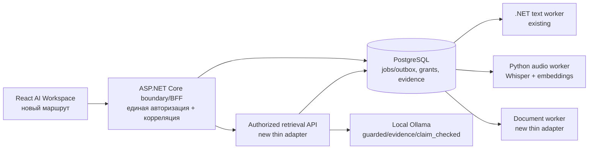
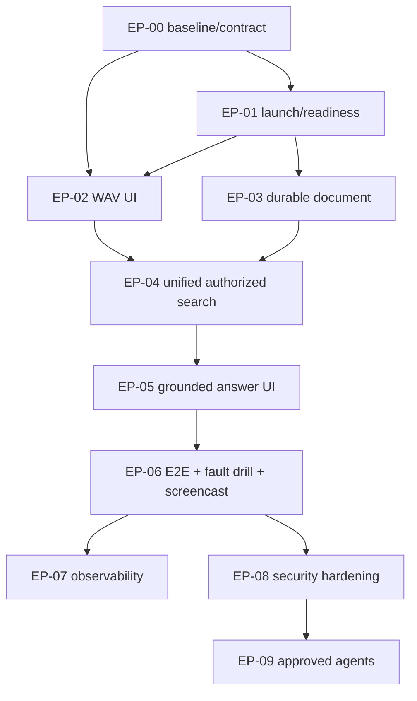

# Enterprise AI Platform — план объединения сервисов demo

**Статус:** PLAN / единый продукт не реализован; EP-00 source inventory зафиксирован, проверки и первый вертикальный срез впереди.  
**Дата среза:** 2026-11-08. **Исходная ветка:** `Sergey303/demo:main`; перед выполнением каждого пакета фиксировать актуальный SHA.  
**Цель:** превратить работающие изолированные примеры в **одну проверяемую Enterprise Knowledge & Meeting Evidence Platform** для демонстрации компетенций .NET Tech Lead / Solution Architect / AI Architect, а не создать ещё один учебный микросервис.

**Главный результат (P0):** пользователь в одном React-интерфейсе, с одной удостоверенной идентичностью, загружает небольшой WAV и документ, видит долговременную обработку, находит разрешённые фрагменты с источниками/таймкодами, задаёт вопрос и получает корректный ответ или отказ. Перезапуск API/worker не теряет принятую работу. Всё подтверждено **реальным PostgreSQL + локальными моделями**, тестами и коротким видео. Ни один шаг не подменяется предзаписанным ответом.

## 1. Что уже есть и чего нет

Это инвентаризация кода, **не** утверждение, что компоненты работают вместе в едином продукте.

| Слой | Реализованная основа в demo | Дефицит до единой платформы |
| --- | --- | --- |
| UI | [React/TS dashboard](../bootstrap5/src/App.tsx), [живое .NET demo](../hiring-demo/README.md), рабочий E2E/screencast | Нет экрана загрузки WAV/документов, истории AI-job, общего поиска/ответов и защищённой пользовательской сессии |
| Долговременная очередь | [.NET Jobs API](../dotnet-outbox/src/Program.cs), [outbox](../dotnet-outbox/src/OutboxWorker.cs), [SQL 001–004](../dotnet-outbox/sql), идемпотентность | Текстовый `/jobs` остаётся публичным; нет единого контракта для документов и связанных событий обработки |
| Аудио | `POST /audio-jobs`, [Python WAV worker](audio_worker.py), Whisper/ONNX, timestamped passages/vector, lease/fencing/heartbeat, [E2E](DURABLE-AUDIO.md) | Только маленький WAV; нет UI, объединённого authenticated search API и индекса по документам |
| Аудиоправа | [HMAC identity + PostgreSQL grants](AUDIO-ACCESS.md), tenant/subject and revocation checks; реальный локальный E2E | Demo HMAC — не OIDC, нет общего authoritative policy для аудио и документов; DB-owning role/RLS не доказаны |
| Документы/RAG | [FastAPI RAG](../python-ai/rag-docs/app/main.py), per-source ACL manifest, evidence / guarded / exact-copy claim modes, локальный Ollama | Документы пока читаются локально и индексируются отдельно; ACL manifest не синхронизирован с PostgreSQL grant/revocation; нет durable document ingestion |
| Retrieval/quality | [Audio search + reranking](../python-ai/audio-search/README.md), [RAG eval](../python-ai/rag-docs/QUALITY-EVAL.md), [blind eval workflow](../python-ai/rag-docs/BLIND-EVAL.md) | Нет общего авторизованного поиска двух типов контента; независимых пользовательских метрик качества ещё нет |
| Инструменты/агенты | [Restricted tool agent](../python-ai/tool-agent/README.md), approval boundary in prototype | Нет end-to-end агентной оркестрации и server-side approval; **не P0** |
| Эксплуатация | `/health`, `/ready`, CI проверяет реальную .NET/PostgreSQL-цепочку | Нет сквозных trace IDs, SLO и одного повторяемого запуска всей AI-цепочки |

**Существующий успешный [Hiring Demo](../hiring-demo/README.md) не заменяем:** это быстрый вход для рекрутера. Новый маршрут `/dashboard/enterprise-ai` должен дополнять его, а не усложнять и ломать показ надёжности.

## 2. Чёткая продуктовая история

**Персона:** сотрудник организации, которому нужно проверить решения и обязательства после совещания; у его коллеги и другой организации не должно быть доступа к чужим данным.

**Сценарий для собеседования (3–4 минуты):**

1. Пользователь A (tenant `alpha`) открывает AI Workspace и видит readiness API, PostgreSQL, audio-worker, retrieval и локальных моделей **по отдельности**; отсутствие сервиса видно как ошибка, без фальшивой зелёной панели.
2. Загружает небольшой, заранее подготовленный **но не предварительно обработанный** WAV; получает `202`, job ID и действительные статусы `queued → done/failed` (в текущем API нет состояния `processing`; отдельную индикацию можно добавить только с серверным контрактом), выполняет повтор с тем же idempotency key без дубля.
3. UI отображает распознанные фразы, источник, старт/конец по времени и ссылку на оригинальное аудио с серверной авторизацией.
4. Загружает небольшую текстовую политику (`.txt`/ограниченный `.md` в MVP) через **durable** document job; видит статус, hash, passages и принадлежность tenant. PDF/Office — не P0.
5. Ищет вопрос по аудио и документу, получает **только разрешённые** фрагменты с типом источника, идентификатором, timestamp (для аудио) или фрагментом документа.
6. Запрашивает evidence-only ответ и отдельно guarded/claim-checked режим локальной LLM. UI показывает цитаты и явно отличает строгую проверку происхождения от **непроверенного семантического entailment**.
7. Администратор в тестовом доверенном интерфейсе отзывает доступ к одному источнику. Следующие результаты поиска, цитаты, просмотр оригинала и LLM prompt для отозванного источника не содержат его. Проверить два разных subject/tenant.
8. На фоне принятой задачи останавливается worker/API, затем запускается снова; принятый job не теряется, lease-фенсинг исключает чужой/stale commit. Видеозапись сохраняет фактические ID и timestamps.

**Критерий успеха:** этот путь реально выполняется из одного UI в изолированном окружении и описан в `README` четырьмя ссылками: «запуск», «демо», «архитектура», «доказательства».

## 3. Целевая архитектура без переписывания компонентов



**Правила границ:**

- **PostgreSQL уже является durable source of truth:** использовать существующие `jobs`, `outbox`, lease/fencing, `audio_read_grants`, сохранённые векторы и схемы; документам добавить минимальные миграции/таблицы. Не строить вторую очередь, не дублировать данные в Redis/отдельном vector DB ради MVP.
- **Одна авторизация для каждого источника и каждой операции.** На первом этапе разрешён единственный **trusted demo issuer**, выпускающий существующий короткоживущий подписанный токен на `tenant,subject`. Никакой публичной выдачи токена клиентом по произвольному tenant; для BFF — trusted server-side issuance или локальный заранее заданный демонстрационный профиль. Production OIDC, RBAC/RLS и lifecycle учётных записей — P1.
- **Разрешения перепроверяются перед поиском, извлечением исходника и формированием prompt**, из единой PostgreSQL модели access/grants, а не из устаревающего копируемого ACL manifest. Нельзя считать просто проверку `tenant_id` полноценной авторизацией.
- **Один BFF/API edge** для браузера; Python inference/search процессы не публиковать напрямую в Интернет. Порт, адрес, origin и proxy — localhost по умолчанию.
- **Model inference вне длительной транзакции**; durable job acceptance до ASR/embedding. Lease + heartbeat + fencing при обработке, атомарная фиксация результата и marker только владельцем lease.
- **Не вводить обязательную LLM-генерацию в critical path загрузки**. Evidence-only работает без Ollama, а отсутствие Ollama вызывает явный `unavailable` только для генерации.
- **Безопасная граница HTML/текста:** показывать контент как текст, не интерпретировать Markdown/HTML из пользовательского документа как системные инструкции, не хранить публичные URL к приватному аудио.

## 4. Пакеты реализации по Парето

Каждый пакет ниже является независимым кандидатом для Codex CLI. `P0` — блокирует показ объединённой цепочки; `P1` — дополнительное усиление найма. Оценки времени — ориентиры, **не обязательства**.

| Пакет | Приоритет | Объём изменений (минимальный) | Зависимости | Готовность / доказательство |
| --- | --- | --- | --- | --- |
| **EP-00 Контракты/карта и evidence baseline** | P0 | Реальный SHA `main`; ревизия DTO, SQL 001–004, API, audio result, embeddings, ACL; typed API examples / errors; одна согласованная диаграмма | Нет | Нет вымышленных эндпоинтов; существующий text+audio E2E/регрессии воспроизводятся; контракт версионирован |
| **EP-01 Единый запуск и readiness** | P0 | Расширить `hiring-demo/run.py` отдельным enterprise-профилем или небольшим launcher; поднять API, audio-worker, retrieval, локальные модели, React; миграции только в **disposable** DB; контролируемая остановка дочерних процессов | EP-00 | Один документированный запуск; readiness отражает реальные зависимости; падение любой обязательной зависимости не маскируется |
| **EP-02 React: WAV upload + job progress** | P0 | Новый `/dashboard/enterprise-ai`; upload с size/type bounds, idempotent retry, status, transcript, timestamps, ошибки/отзыв; использовать текущий `POST /audio-jobs` и `GET /jobs/{id}` | EP-00/01 | Реальный браузер → .NET → PG → Python Whisper → JSON result; нет подставного транскрипта; same key = same ID; restart recovery |
| **EP-03 Durable document ingestion** | P0 | Минимальный `document` kind, migration 005+ только для новой схемы, text-only bounded payload, document worker/processor, persisted passages/embeddings, source ID/tenant/owner grant; повтор использовать outbox/leases | EP-00/01 | `202` до эмбеддинга; POST повтор идемпотентен; crash/retry без двойного результата; не принимать неизвестные форматы |
| **EP-04 Unified authorized search** | P0 | Узкий authenticated query/search adapter: разрешённые audio/document segments из PG; source ID, timestamps, chunks, cosine score; grant check SQL **до** выдачи; бюджет `top_k`; один embedding contract | EP-02/03 | Запрос к двум источникам возвращает только owner-granted snippets; tenant B и revoked subject ничего не получают, включая метаданные/извлечение оригинала |
| **EP-05 Evidence/grounded answer UI** | P0 | Подключить существующие `evidence`, `guarded`, `claim_checked` к единым авторизованным фрагментам через адаптер; явный `abstained`, source badges; не копировать старый manifest policy в runtime | EP-04 | Нет источника → отказ **без вызова LLM**; некорректные цитаты → отказ; revoked source не попадает в prompt; точная цитата ≠ семантическая достоверность |
| **EP-06 End-to-end CI, fault drill, видео** | P0 | GitHub Actions: disposable PG 001–latest, реальный .NET API, Python worker, локальная малая модель/фиксируемый кэш либо явно отдельный opt-in inference тест; Playwright, worker kill/reclaim/retry, artifact/video | EP-01–05 | **Один подтверждённый интеграционный trace**: upload→persist→search→answer; multi-tenant negative + revoke + outage + recovery. Нельзя считать mock smoke равным model-backed E2E |
| **EP-07 Observability + SLO** | P1 | Correlation/trace IDs across HTTP/PG/jobs/worker/search, OpenTelemetry traces, job age, queue lag, ASR duration, failed count; аварийный runbook | EP-06 | Сквозной trace и измеренный restart/job recovery, p50/p95 с аппаратной конфигурацией и числом запросов; никаких выдуманных SLO |
| **EP-08 Security/prod deployment hardening** | P1 | OIDC, DB role separation, RLS decision, retention/delete, quotas, upload parser sandbox, object storage if justified, secrets management, audit, HTTPS/reverse proxy | EP-06 | Threat model + отрицательные e2e на tenancy/expiry/revocation, доказательства безопасного удаления |
| **EP-09 Agent approvals/MCP** | P1 | `tool-agent` как строго ограниченный инструмент чтения; для записи серверное одноразовое подтверждение, immutable digest и audit; Planner только после стабильного P0 | EP-06/08 | Тест client `approved=true` не выдаёт полномочий; повтор/подмена/expiry безопасно отклоняются |

**Оптимальный первый coding пакет:** **EP-00 + минимальная часть EP-01 и EP-02 на реальном аудио**, а не новый planner и не целая облачная инфраструктура. К первому PR полезнее всего получить working browser → audio job → stored transcript + timestamps на одной модели; document ingestion добавить следующей поставкой.

## 5. Dependency graph / вертикальные срезы



**Вертикальный срез A (первый показ):** authenticated WAV → PostgreSQL job/outbox → Whisper worker → persisted transcript → React timestamps.  
**Срез B (единая платформа):** WAV + text-document → common grant-aware search → evidence-only answer → guarded LLM if available.  
**Срез C (архитектурное доказательство):** revoke, wrong tenant, no-source refusal, API/worker crash, idempotent recovery → CI + видео + operational dashboard.

**Не расширять P0:** PDF/OCR/DOCX, видеозвонки, streaming ASR, Kubernetes, Terraform, Redis/брокер, multi-GPU/vLLM, RLS/OIDC production, stateful LLM planner, multi-region, infinite history. Всё это отдельные решения, только если есть реальные требования и доказательства ценности.

## 6. Проверяемые критерии приёмки P0

- [ ] `EP-00`: SHA/контракт/матрица реализованного зафиксированы; все относительные ссылки/команды в документации работают; старые режимы не ломаются.
- [ ] `EP-01`: один запуск готовит **только disposable** ресурсы и проверяет PostgreSQL, .NET, Python, retrieval; отсутствие модельного сервиса не притворяется `ready` для LLM.
- [x] `EP-02` **ограниченный синтетический WAV-сценарий**: фактические 202/200, один job ID, Whisper→persisted transcript, запрет неавторизованного чтения и отзыв прав проверены Chromium+PG; [evidence](../enterprise-demo/EVIDENCE-2026-11-08.md). Не заявлять долгосрочную устойчивость или production-авторизацию.
- [ ] `EP-03`: document POST/worker/retry/crash при сохранённых payload/metadata, без двойного результата; новая миграция соответствует текущим 001–004.
- [ ] `EP-04`: SQL/grant tests подтверждают отсутствие межtenantских утечек до и после revoke, в том числе через top-k, исключения и LLM prompt.
- [ ] `EP-05`: есть evidence answer с source/time; no-evidence → отказ; при неправильном citation ID/неподтверждённом контексте нет ложной уверенности.
- [ ] `EP-06`: проходит реальный CI на пустой PostgreSQL с миграциями, отдельной Python ASR и локальной моделью; fault injection в корректной фазе; доступны trace/evidence, короткий screencast и команды повтора.
- [ ] Ограничения/известные дефекты описаны; в публичном README **не написано** «production-ready», «без галлюцинаций» или «exactly once side effects», пока это не доказано.

### Минимальная негативная матрица тестов

| Ситуация | Ожидаемый результат |
| --- | --- |
| user B / wrong tenant запрашивает job, audio blob, document passage | единообразный отказ/404 без раскрытия ID, имени, содержимого или существования |
| admin отзывает grant; user A повторяет search/answer | нет отозванного результата, и LLM запрос его не содержит |
| одинаковый idempotency key + разные payload | 409 без новой задачи |
| worker убит после claim до finalize | lease expires; другая обработка завершает; stale worker cannot commit |
| модель не работает | evidence-only доступен; generation обозначена как unavailable или отказ |
| corrupted audio / слишком крупный документ / пустой вопрос | ограниченный отказ без падения сервиса или утечки body |
| транзакция БД обрывается | нет принятого результата без commit, повтор восстанавливается |
| «инструкция» внутри источника требует раскрыть чужой документ | retrieved text treated as data; no unauthorized tool call, no leaked snippet |

## 7. Политика тестирования и публикации

Сначала запустить существующие локальные проверки **без новых model downloads**:

```bash
python -m pytest -q architecture/tests
cd python-ai/rag-docs && python -m pytest -q tests
cd ../../dotnet-outbox && dotnet test tests/ReliableJobs.Tests.csproj
cd ../bootstrap5 && npm run build && npx playwright test tests/hiring-demo.spec.ts
```

Реальные PostgreSQL-тесты — **только** против отдельной `reliable_jobs` с полными миграциями `001_init.sql` → `002_audio_jobs.sql` → `003_audio_leases.sql` → `004_audio_acl.sql` → новых миграций. Для Python libpq и .NET Npgsql использовать соответствующие форматы DSN; не переиспользовать рабочие БД других проектов.

**Уровни доказательств записывать раздельно:** source inspection → unit → contract → live PostgreSQL → live local Whisper/Ollama → browser E2E → deliberate failure/recovery. Без записи Git SHA, модели, hardware/RAM, входных данных, команд и logs не публиковать численные результаты как воспроизводимые.

**Сложный релиз:** никогда не запускать DEV/E2E «случайно» из PR; выделить допустимые безопасные локальные тесты и opt-in интеграционные проверки. GitHub Actions использует одноразовые ресурсы; runner обязан чистить созданные процессы. При редактировании публичного README факт из target-диаграммы не переносить в implemented до CI evidence.

## 8. Definition of Done для каждой задачи Codex

1. Перед началом `git fetch origin main` и сохранить точный `base_sha`; прочитать `AGENTS.md`, этот план, связанный ADR и актуальный код.
2. Сформулировать один контракт (вход/выход, ошибки, auth, persistence, idempotency), разрешённые пути изменений и **один проверяемый end-to-end результат**; не плодить параллельных реализаций.
3. Реализовать на существующих механизмах. Не изменять несвязанные файлы или чужие незакоммиченные изменения; не изменять `main` без независимого ревью.
4. Добавить положительные и отрицательные тесты, fault scenario для соответствующего среза, выполнить `git diff --check`.
5. **Отдельный reviewer / Codex CLI review**, устранить конкретные замечания, проверить фиксацию миграций и ACL. При наличии `repo-context`/`rc-evidence` можно привязать артефакты по SHA; это инструменты других репозиториев, не обязательная dependency demo.
6. Обновить только актуальные контракты и статусы, записать: tested/not tested, среду, SHA, ссылки на CI evidence; commit/push только согласованных изменений.
7. В `main` принимать пакет при зелёных проверках; не объявлять EP-x закрытым по одному unit test.

## 9. Риски и premortem

| Почему «платформа» может провалиться | Предотвращение |
| --- | --- |
| «Собрали десяток сервисов, но работодателю непонятно, что работает» | Первый экран + один сквозной 3–4-минутный сценарий; короткий путь в README |
| Непоследовательная авторизация в .NET, Python и фронте | Один token/principal, один authoritative grant check; отрицательные тесты **на каждом** границе |
| Очередь и vector storage начинают дублировать PostgreSQL | Прежде расширить существующие jobs/outbox/segments и использовать индекс без отдельной БД |
| Локальная модель не влезает в память или исчерпывает pids в RDC | Evidence-only обязательно без LLM; небольшой CPU-профиль, bounded concurrency и авто-выгрузка модели |
| Миграции на пустой PG отсутствуют в CI | Миграционный ledger и CI с чистой базой 001→latest; успешность `/ready` не заменяет schema check |
| Демонстрация красиво цитирует неправду | Синтаксическая цитата ≠ entailment; строгий refusal, human review, независимая слепая разметка отдельно |
| Излишний scope (MCP/Cloud/Kubernetes) съедает время найма | P0 — вертикальная цепочка и видео, P1 — агент/инфра лишь после подтверждённой E2E |

## 10. С чего начинать прямо сейчас

**Сделано по EP-00 (статическая ревизия):** [фактический контракт и карта пробелов](enterprise-platform/contracts.md), основанные на `main` @ `f926104dbc7b5d13423492ba358ec3c832156f2d`. Выполнение тестов/миграций, live audio и независимая приёмка **ещё не проведены** — галочка EP-00 остаётся открытой.

**EP-02 принята в пределах малого синтетического WAV:** [реальный E2E, скриншот, видеозапись, команды и ограничения](../enterprise-demo/EVIDENCE-2026-11-08.md). Два браузерных прохода с Whisper+ONNX и PostgreSQL завершились успешно; дополнительные 8/8 PostgreSQL проверок worker/reclaim/lease-fencing — PASS. При последующем длительном запуске API завершился с `Out of memory`; требуется отдельная диагностика памяти/soak. Общую готовность Python-моделей `/ready` не заявляет; **EP-01 остаётся частично незакрытой**.

**Следующая конкретная задача:** выделить минимальные критерии готовности AI worker и разобраться с устойчивостью при длительной работе на RDC, затем **EP-03** — durable ingestion документов, за которым следует **EP-04** — объединённый поиск с проверкой прав. Не вводить новую очередь и агентов преждевременно.

**Первый публичный milestone:** authenticated upload WAV из нового React экрана + worker-backed persisted transcript and timestamps + correct retry/revoke tests, проверенные на пустой disposable PostgreSQL. Только после этого добавлять документы и unified answer.

---

**Связанные документы:** [EP-00 contracts](enterprise-platform/contracts.md) · [архитектура](README.md) · [durable audio](DURABLE-AUDIO.md) · [audio access](AUDIO-ACCESS.md) · [RAG](../python-ai/rag-docs/README.md) · [Hiring Demo](../hiring-demo/README.md) · [матрица рисков](failure-matrix.md).
