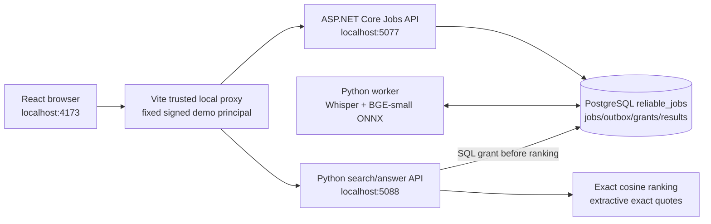
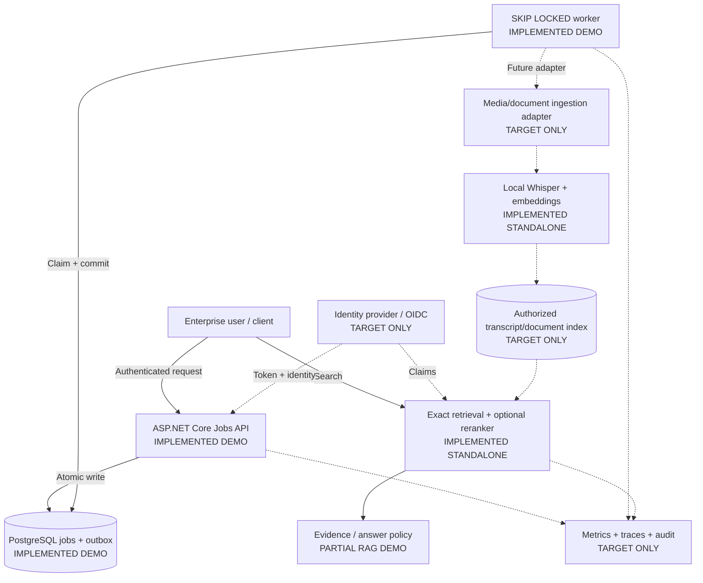

# Architecture case: Enterprise Knowledge & Meeting Evidence Platform

**Problem:** A regulated organization needs searchable evidence from internal meetings and policy documents. Search results must retain source references, audio timestamps and clear limits on confidence. Processing should survive worker restarts without silently losing accepted work. The **bounded local WAV + Markdown → authorized evidence search → extractive exact-quote answer** has been built and demonstrated end-to-end, while production identity, operational scale and LLM-generated answers remain target-only. [Real EP-05 browser/video evidence](../enterprise-demo/EVIDENCE-2026-11-09-ANSWER.md).

**Why this case:** It exercises RAG, local inference, async ingestion, identity boundaries, model evaluation and incident recovery. The portfolio now integrates the **bounded** WAV and text-document paths through one .NET/PostgreSQL jobs/outbox, shared Python worker, SQL tenant/subject grants, local ONNX search and exact-source answer UI. Production OIDC/RLS, complete document formats, agent authorizations, comprehensive quality evaluation, audit and operational hardening are not implemented. Do not advertise this as a production AI platform.

**Implementation status (2026-11-09):** [Enterprise AI Platform plan](ENTERPRISE-AI-PLATFORM-PLAN.md) defines EP-00–EP-09; EP-02–EP-05 have real bounded browser/DB/model acceptance with source files, [20.2s actual Chromium video](../enterprise-demo/media/enterprise-answer-real.mp4), SQL negative tests and transparent limitations. The next gap is EP-06 operational/fault acceptance. **The C4 drawing below remains a target diagram**, not a depiction of the currently deployed localhost demo; see the as-built picture first.

## As-built local demonstration (EP-02–EP-05)



This is **not** an IAM/multi-user deployment; any browser reaching the locally trusted proxy shares the same fixed demo identity. PostgreSQL authorizes before selecting source passages, and a new answer request repeats that query. An excerpt's provenance does not prove it answers the question. [Verified behavior and known limits](../enterprise-demo/EVIDENCE-2026-11-09-ANSWER.md).

## C4 container view (target, with implementation status)



**Actual code**: [Jobs API](../dotnet-outbox/src/Program.cs), [worker](../dotnet-outbox/src/OutboxWorker.cs), [schema](../dotnet-outbox/sql/001_init.sql), [Whisper pipeline](../python-ai/audio-search/pipeline.py), [retrieval](../python-ai/audio-search/search.py), [reranking](../python-ai/audio-search/rerank.py), [document RAG](../python-ai/rag-docs/app/core.py), [HTTP tool boundary](../python-ai/tool-agent/app/main.py). **The EP-02–EP-05 path now connects Jobs API, Whisper/document ONNX, PostgreSQL grants and a local extractive answer API**: [runbook](../enterprise-demo/README.md), [search](unified_search.py), [answer](evidence_answer.py), [real screenshot/video](../enterprise-demo/EVIDENCE-2026-11-09-ANSWER.md). Other repositories and the target C4 remain broader or standalone.

## Functional and quality contracts

| Contract | Target acceptance check | Present evidence |
| --- | --- | --- |
| Accepted jobs are durable | POST returns accepted only after job + outbox are committed; duplicate keys do not create another job | [HTTP smoke + PostgreSQL tests](../dotnet-outbox/tests); [verified local run](../dotnet-outbox/README.md) |
| Worker crash does not lose accepted work | Kill process after claim but before commit; restart and check same job eventually completes | Audio worker child-process termination, lease reclaim and fencing tested; text worker process crash remains untested |
| Document/audio result has provenance | Every result carries source, audio start/end or document passage; permissions evaluated **before** ranking and returning evidence | [audio ACL retrieval](audio_worker.py) and [signed identity](../dotnet-outbox/src/AudioIdentity.cs) verified on PostgreSQL and in the full HTTP + Whisper smoke (2026-11-07); EP-03/04/05 use **one PostgreSQL grant table** for document and audio; the standalone document RAG has a different manifest ACL and is not the authorization source of this integrated path |
| AI quality change is gated | Frozen labeled queries; compare paired errors and latency; reject tiny datasets | [Executable quality/latency gate](decision_gate.py) + [tests](tests/test_decision_gate.py); present datasets are tiny and synthetic |
| No unauthorized writes through public agent API | HTTP clients cannot self-approve actions | [Tool API](../python-ai/tool-agent/app/main.py) and [tests](../python-ai/tool-agent/tests/test_agent.py); authenticated approval workflow **not implemented** |
| Traceability and operational readiness | Job ID / trace ID links ingress, processing, indexing and search, with queue lag and inference latency | **Target only**; `/health` and `/ready` exist for Jobs API |

## Decision records

- [ADR-001: PostgreSQL outbox vs broker](adr/001-outbox-vs-broker.md)
- [ADR-002: Local models vs managed AI](adr/002-local-models-vs-managed-ai.md)
- [ADR-003: Exact/ANN retrieval and reranking](adr/003-retrieval-quality-cost.md)
- [Failure and trust-boundary matrix](failure-matrix.md)

## Decision fitness function — executable, not a presentation-only table

The [holdout evaluation](../python-ai/audio-search/evaluate_holdout.py) outputs paired baseline/reranked results. This gate checks that the *same questions* and labels were used, recomputes top-1 from each query, counts both improved and regressed queries, and checks a caller-defined latency budget. The default **minimum 100 questions** deliberately prevents treating the existing 12-question synthetic set as proof of a deployable improvement.

```bash
cd python-ai/audio-search
python evaluate_holdout.py > ../../architecture/holdout-local.json
cd ../..
python architecture/decision_gate.py architecture/holdout-local.json --min-questions 100 --max-median-ms 150
python -m pytest -q architecture/tests
```

The generated JSON is intentionally local and should not be committed as authoritative evidence without recording environment, dates and model versions. `ELIGIBLE_FOR_FURTHER_REVIEW` means **not yet approved**: statistical uncertainty, security, per-tenant access, cost and end-to-end user outcomes are additional gates. See [ADR-003](adr/003-retrieval-quality-cost.md).

## Runnable cross-project slice: actual ASR → durable text receipt → semantic search

[`evidence_flow.py`](evidence_flow.py) connects **existing actual interfaces**, rather than simulating the architecture on slides. It locally runs `faster-whisper` on an audio file, sends the timestamped transcript to `POST /jobs` with a stable SHA-256-derived idempotency key, waits for the .NET outbox worker's persisted digest to match, then retrieves timestamped semantic hits with `fastembed` neural embeddings. The runner rejects empty/oversized transcripts and refuses remote API destinations. [Contract tests](tests/test_evidence_flow.py) cover deterministic repeat submission, no-speech rejection, digest mismatch, URL restrictions and request bounds.

```bash
# In one terminal, from dotnet-outbox/, with the demo-only PostgreSQL available:
export ConnectionStrings__Jobs='Host=demo-outbox-postgres;Port=5432;Database=reliable_jobs;Username=demo;Password=demo'
dotnet run --project src/ReliableJobs.csproj --urls http://127.0.0.1:5077

# In another terminal, from repository root, after installing faster-whisper,
# fastembed, numpy and the FFmpeg executable, run a real local audio case:
ffmpeg -f lavfi -i "flite=text='The refund policy allows thirty days for a return':voice=slt" -ar 16000 -ac 1 /tmp/evidence-sample.wav
python architecture/evidence_flow.py /tmp/evidence-sample.wav --question 'How long can I return a purchase?'
python -m pytest -q architecture/tests
```

**Critical trust/durability boundary:** ASR is performed **before** acceptance into the durable job. If the process dies during ASR, the accepted-work guarantee does not apply to that audio. The .NET worker verifies/persists the *transcript text* as its existing deterministic word-count/SHA job; it does **not** run Whisper, maintain a shared index, or commit vector embeddings transactionally. The transient search index exists only during this CLI invocation. This slice demonstrates real interface interoperability, not end-to-end durable AI ingestion, multi-tenant authorization, or production SLOs.

**Evidence status (2026-11-06):** 10/10 contract/decision tests passed. A new live PostgreSQL + model run was **blocked** by temporary DNS failure for `demo-outbox-postgres` in RDC; do not count the cross-project E2E as validated until the database is reachable again. The individual PostgreSQL Outbox E2E was previously validated on 2026-11-05 (separate run).

## Tenant-aware audio access

The [audio access controls](AUDIO-ACCESS.md) bind signed user identity to a tenant and explicit PostgreSQL read grants; the audio upload and result API and the Python retrieval service check grants. The standalone document RAG also enforces per-source manifest ACL on its HTTP search and local LLM input. Revocation is enforced on subsequent reads, without a per-user result cache. This is a narrow demonstrator, not an OIDC/RLS production system.

## Durable audio before inference

The [durable audio extension](DURABLE-AUDIO.md) accepts WAV bytes into the existing PostgreSQL outbox **before** AI inference and uses a dedicated Python worker to persist timestamped passages plus embeddings atomically. This is a runnable implementation with tests, verified with a live end-to-end run on isolated PostgreSQL on 2026-11-07 (see the runbook evidence). It now uses short claim/finalize transactions and a fenced expiring lease, with inference outside PostgreSQL transactions; heartbeat renewal is implemented and verified with synthetic slow handlers and small concurrent-worker tests; production load/monitoring remain unverified.

## Architecture review questions

1. What must be true to promise *at-least-once* handling vs exactly-once external effects? Where is deduplication enforced?
2. Can a hidden document leak through embeddings, search ranking or an audio source reference? How does permission revocation invalidate cached results?
3. Does the workload justify GPU inference, external APIs, or batching? Which p95 SLO and data residency restrictions apply?
4. Does the increased query latency of a cross-encoder justify the measured gain for *held-out real users*? When would the gate prohibit rollout?
5. Which telemetry and failure drills prove service recovery rather than just unit-level correctness?

These are genuine open decisions rather than implemented claims. The next highest-value increment is **verified tenant-isolation/revocation evidence**, then representative blind quality evaluation and grounded abstention, rather than another architecture diagram.

## Measured AI answer-quality limitations

The [RAG quality case](../python-ai/rag-docs/QUALITY-EVAL.md) uses a local neural embedder, a verbatim citation mode, explicit abstention and a release gate. On 28 authored cases it found false answers and a wrong source, so the gate **fails**: this is evidence of a working evaluation process, not evidence of production-grade faithfulness.
