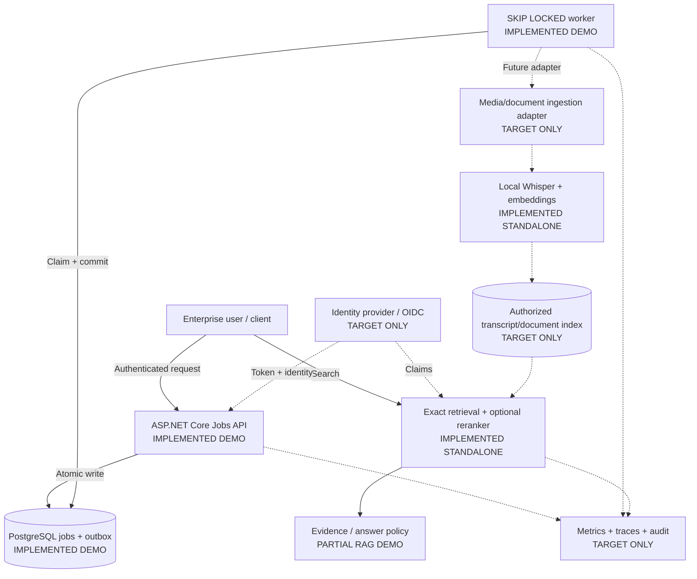

# Architecture case: Enterprise Knowledge & Meeting Evidence Platform

**Problem:** A regulated organization needs searchable evidence from internal meetings and policy documents. Search results must retain source references, audio timestamps and clear limits on confidence. Processing should survive worker restarts without silently losing accepted work. This is a **target architecture**, not an implemented end-to-end product.

**Why this case:** It exercises RAG, local inference, async ingestion, identity boundaries, model evaluation and incident recovery. The portfolio contains functioning implementations of its *parts*. The shared upload API, storage, auth, worker-to-AI adapter, audit and end-to-end policy enforcement do not yet exist. Do not advertise this as a production AI platform.

## C4 container view (target, with implementation status)



**Actual code**: [Jobs API](../dotnet-outbox/src/Program.cs), [worker](../dotnet-outbox/src/OutboxWorker.cs), [schema](../dotnet-outbox/sql/001_init.sql), [Whisper pipeline](../python-ai/audio-search/pipeline.py), [retrieval](../python-ai/audio-search/search.py), [reranking](../python-ai/audio-search/rerank.py), [document RAG](../python-ai/rag-docs/app/core.py), [HTTP tool boundary](../python-ai/tool-agent/app/main.py). **No code currently connects Jobs API to Whisper.**

## Functional and quality contracts

| Contract | Target acceptance check | Present evidence |
| --- | --- | --- |
| Accepted jobs are durable | POST returns accepted only after job + outbox are committed; duplicate keys do not create another job | [HTTP smoke + PostgreSQL tests](../dotnet-outbox/tests); [verified local run](../dotnet-outbox/README.md) |
| Worker crash does not lose accepted work | Kill process after claim but before commit; restart and check same job eventually completes | PostgreSQL transaction rollback/reclaim primitive tested; **process-level chaos not tested** |
| Document/audio result has provenance | Every result carries source, audio start/end or document passage; permissions evaluated **before** ranking and returning evidence | [Audio hits](../python-ai/audio-search/search.py), [document hits](../python-ai/rag-docs/app/core.py); **authorization filtering not implemented** |
| AI quality change is gated | Frozen labeled queries; compare paired errors and latency; reject tiny datasets | [Executable quality/latency gate](decision_gate.py) + [tests](tests/test_decision_gate.py); present datasets are tiny and synthetic |
| No unauthorized writes through public agent API | HTTP clients cannot self-approve actions | [Tool API](../python-ai/tool-agent/app/main.py) and [tests](../python-ai/tool-agent/tests/test_agent.py); authenticated approval workflow **not implemented** |
| Traceability and operational readiness | Job ID / trace ID links ingress, processing, indexing and search, with queue lag and inference latency | **Target only**; `/health` and `/ready` exist for Jobs API |

## Decision records

- [ADR-001: PostgreSQL outbox vs broker](adr/001-outbox-vs-broker.md)
- [ADR-002: Local models vs managed AI](adr/002-local-models-vs-managed-ai.md)
- [ADR-003: Exact/ANN retrieval and reranking](adr/003-retrieval-quality-cost.md)
- [Failure and trust-boundary matrix](failure-matrix.md)

## Decision fitness function — executable, not a presentation-only table

The [holdout evaluation](../python-ai/audio-search/evaluate_holdout.py) outputs paired baseline/reranked results. This gate checks that the *same questions* and labels were used, recomputes top-1 from each query, counts both improved and regressed queries, and checks a caller-defined latency budget. The default **minimum 100 questions** deliberately prevents treating the existing 12-question synthetic set as proof of a deployable improvement.

```bash
cd python-ai/audio-search
python evaluate_holdout.py > ../../architecture/holdout-local.json
cd ../..
python architecture/decision_gate.py architecture/holdout-local.json --min-questions 100 --max-median-ms 150
python -m pytest -q architecture/tests
```

The generated JSON is intentionally local and should not be committed as authoritative evidence without recording environment, dates and model versions. `ELIGIBLE_FOR_FURTHER_REVIEW` means **not yet approved**: statistical uncertainty, security, per-tenant access, cost and end-to-end user outcomes are additional gates. See [ADR-003](adr/003-retrieval-quality-cost.md).

## Architecture review questions

1. What must be true to promise *at-least-once* handling vs exactly-once external effects? Where is deduplication enforced?
2. Can a hidden document leak through embeddings, search ranking or an audio source reference? How does permission revocation invalidate cached results?
3. Does the workload justify GPU inference, external APIs, or batching? Which p95 SLO and data residency restrictions apply?
4. Does the increased query latency of a cross-encoder justify the measured gain for *held-out real users*? When would the gate prohibit rollout?
5. Which telemetry and failure drills prove service recovery rather than just unit-level correctness?

These are genuine open decisions rather than implemented claims. The next highest-value coding increment is a **single working Jobs→Audio adapter with contract tests and failure injection**, not another diagram.
