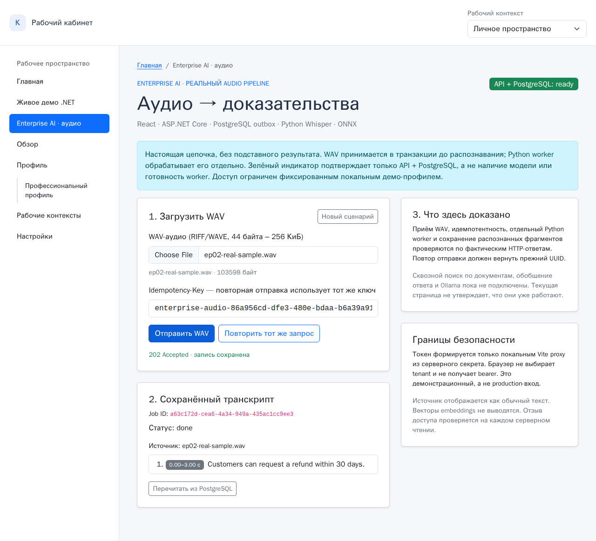

# EP-02 acceptance: real Whisper and PostgreSQL browser run — 2026-11-08

**Scope:** public engineering portfolio, synthetic speech only. The code under test was `main` @ `e3e3f047332e66f238975cc46ee77f8de656b74f`. New opt-in Playwright acceptance test and its evidence are versioned with this report; the exact result is not a claim about later SHAs.

**Result:** **two full Chromium→React→ASP.NET Core→PostgreSQL→Python faster-whisper/ONNX→persisted transcript passes**. First run: **28.6 s test** including cold-ish local model startup; second run: **7.0 s test** with warmed model/cache. These are observed wall-clock *test* durations, not throughput, average latency, or an SLO.

[Watch the actual Chromium recording (MP4, 6.5 seconds)](media/enterprise-ai-real-whisper.mp4) · [Inspect the full-page screenshot](media/enterprise-ai-real-whisper.png)



## What passed, with real dependencies

| Boundary | Observed evidence |
| --- | --- |
| Browser → trusted local Vite proxy → .NET | Real, non-stubbed `202 Accepted` with unique job UUID for uploaded WAV |
| Atomic acceptance / worker | PostgreSQL row `kind=audio`, `status=done`, one outbox event with `processed_at` set, `attempts=0` on first run |
| Models | `faster-whisper tiny.en` CPU int8, FastEmbed BGE-small (384-dim ONNX vector); original FFmpeg/Flite synthetic speech WAV, 103,598 bytes |
| Actual transcript | `Customers can request a refund within 30 days.` at **0.0–3.0 seconds**, one persisted searchable segment |
| Idempotency | Browser retries same WAV and key; receives `200 already-accepted` and the original ID |
| Read authorization | Direct request to .NET without bearer → 404; authorized browser read → 200, then trusted admin revoke → next browser read 404 and transcript is removed from UI |
| Previous job after API restart | Fresh .NET API returned `/ready` 200; previous PostgreSQL result still had `status=done` and the original segment; unauthorized direct read remained 404 |
| Worker fault and concurrency testing | **8/8** actual PostgreSQL tests in `architecture/tests/test_audio_postgres.py` passed, including terminating a child worker during inference, lease reclaim, stale write fencing, heartbeat, concurrent claims and bounded retry |

The screenshots/video are **real captured browser state** from the second passing run, not a mock animation or a prefilled transcript. The system uses a tiny *synthesized* one-speaker clip, so recognition quality on real meetings and production throughput remain unmeasured. The source has no speaker diarization, PDF/documents or unified RAG on this route.

## Reproduction (use only a disposable demo database)

1. Check model cache and available memory/disk; do not initialize or migrate a ChatPilot/KnowledgePilot DB. Install `architecture/audio-requirements.txt` only if your isolated Python environment lacks dependencies.
2. Start the isolated `reliable_jobs` PostgreSQL and apply **001→004** in order. On RDC, Docker uses a **remote host**: bind-mounting a path that exists only inside RDC fails. For this run we used the already-available `postgres:16` image, temporary `--tmpfs /var/lib/postgresql/data:rw,size=512m`, and piped each SQL file with `docker exec -i ... psql ... < dotnet-outbox/sql/<file>`. Remove only the acceptance container after testing.
3. For Docker-host networking from RDC, set both DSNs to `host.docker.internal`, port `55432`, database `reliable_jobs` using their different syntaxes (Npgsql vs libpq). Use a freshly generated 32+ byte `DEMO_AUTH_SECRET` in the launcher environment; never put it in the browser or commit it.
4. Generate the real test clip (Flite feature of FFmpeg required):

```bash
ffmpeg -y -f lavfi -i "flite=text='Customers can request a refund within thirty days':voice=slt" -ar 16000 -ac 1 -c:a pcm_s16le /tmp/ep02-real-sample.wav
```

5. Start the genuine API, worker and Vite with `python enterprise-demo/run.py`. In another shell with the same isolated DB DSN:

```bash
cd bootstrap5
LIVE_ENTERPRISE_AUDIO=true \
ENTERPRISE_WAV_PATH=/tmp/ep02-real-sample.wav \
EP02_TEST_PYTHON=/path/to/python-with-psycopg \
npx playwright test tests/enterprise-ai-live.spec.ts --workers=1
```

The test performs a **trusted test-only administrative revoke** via Python `audio_access.revoke_read` using the disposable DB DSN; it is not an HTTP endpoint and must not run with real data or permissions. It records video/screenshot under ignored `bootstrap5/test-results/`. Without `LIVE_ENTERPRISE_AUDIO=true` the test is skipped; normal browser-contract CI remains independent of a model.

To rerun the actual PostgreSQL resilience suite after stopping the launcher/worker:

```bash
JOBS_TEST_CONNECTION='host=host.docker.internal port=55432 dbname=reliable_jobs user=demo password=demo' \
python -m pytest -q architecture/tests/test_audio_postgres.py
```

## Known negative observation (must not be hidden)

A **third** browser attempt later failed **before upload**: after several minutes of concurrent services, the .NET API exited with `Out of memory`; the launcher noticed and shut down its own children, so the UI showed `unavailable` instead of a false success. At inspection time RDC had high overall memory pressure and many Chromium renderer processes, but this does **not** prove the cause of the .NET allocation failure. The kernel cgroup showed `oom_kill=0`. Prolonged soak reliability is **not** demonstrated; reproduce this issue under controlled load if the demo is to be left running for long periods. Existing transient happy-path and worker-recovery guarantees do not imply a production SLO.

**Next technical gap:** the authorized `GET /jobs/{id}` still transports embedding vectors inside JSON even though the React UI only displays text and timecodes; a narrow transcript-only response is desirable before expanding content size. Worker/model readiness is not covered by current `/ready`. EP-03 document ingestion, EP-04 unified authorized retrieval and EP-05 grounded answer remain future releases.
