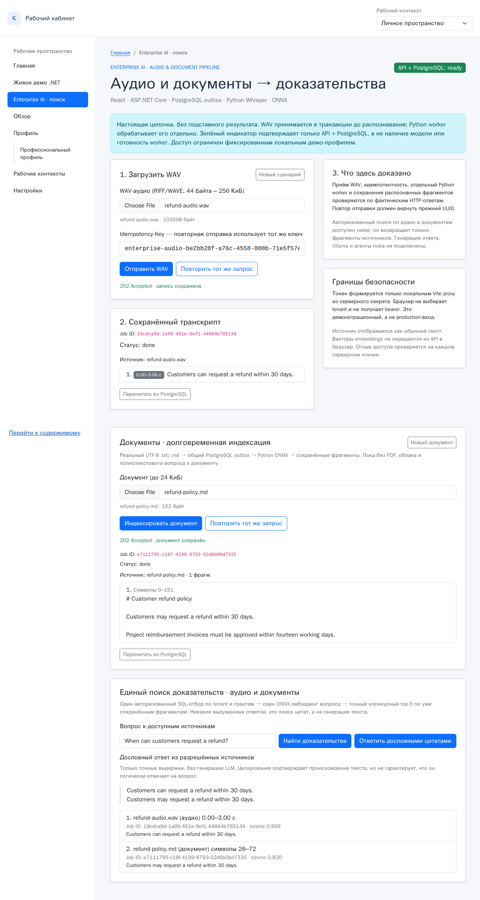

# EP-05 — дословный ответ с проверяемыми цитатами (2026-11-09)

**Источник перед изменениями:** публичный `main` @ `27d16258aa54c3f1eec85e1dc06bb25836d77d8c`. Испытания проводились в изолированной ветке `feature/ep05-grounded-evidence`, с disposable PostgreSQL 16, .NET 10, настоящими локальными Whisper tiny.en и BGE-small/ONNX, Vite/React, Playwright Chromium и полностью **синтетическими** данными.

**Результат: подтверждённый ограниченный EP-05 evidence-only режим.** Это *не* генеративный ответ, RAG на LLM и не доказанная семантическая корректность. Ответ — конкатенация максимум **двух дословных оригинальных цитат**; в Markdown выбирается полное предложение, которое пересекается по значимым словам с вопросом. Сходство и совпадение слов **не доказывают** entailment. Отсутствие совместимых разрешённых или пороговых доказательств → явный отказ, без вызова LLM.

[Видео подлинного браузерного сценария — 20,2 с](media/enterprise-answer-real.mp4) · [Скриншот реального ответа и цитат](media/enterprise-answer-real.png)



## Реальные наблюдения

1. Из браузера в одной последовательности загружены **оригинально синтезированный WAV** `refund-audio.wav` (103 598 байт) и `refund-policy.md` (152 байта). Через реальный .NET API и PostgreSQL outbox оба обработаны Python worker; WAV → Whisper со временем `0.00–3.00` с, Markdown → ONNX-векторы BGE-small, результаты `done`. Никакие ответы HTTP не подменялись.
2. Запрос *“When can customers request a refund?”* через `POST /enterprise-search/answer` прошёл **отдельную проверку HMAC tenant/subject и текущих грантов** перед извлечением фрагментов из PostgreSQL. Векторы использованы только на сервере, в браузер не отправлялись.
3. **Ответ состоит ровно из двух дословных выдержек** (без LLM): “Customers can request a refund within 30 days.” (аудио, `0.00–3.00` c) и “Customers may request a refund within 30 days.” (документ, символы `26–72`). Браузер показывает источник, исходный job UUID, тип и диапазон. Соседнее предложение Markdown про утверждение счетов **не включается в ответ**.
4. Прямой запрос без токена → **401**. Токен другого tenant возвращает только источники этого tenant (в синтетическом acceptance-сценарии — пусто). После доверенного удаления гранта документа **следующий** запрос возвращает только аудиовыдержку; после удаления второго гранта — **`abstained=true`**, пустые `citations` и сообщение «Недостаточно разрешённых доказательств». Прежний ответ очищается из UI.
5. Два реальных браузерных прохода EP-05: первоначальный **27,3 с**, после улучшения документной цитаты **20,3 с** (длительности всего теста, не latency одного запроса или производительность). Сохранены PNG и MP4 именно **последнего** прохода.

## Почему ответ надёжен в пределах контракта

- Клиент передаёт **только `question` и `top_k`**, не может передать свободный `answer`, `tenant` или свои цитаты; неизвестные поля отклоняются `422`.
- `/answer` повторно вызывает единый подписанный и SQL grant-aware поиск, а не использует браузерные результаты или отдельный ACL manifest. Отзыв прав проверяется на **следующем** запросе (не гарантия прерывания уже вычисляемого ответа на уровне межпоточной гонки).
- Ответ не перефразирует: цитата содержит точный текст исходного фрагмента. Для документа выбор полного предложения не обрезает отрицание внутри предложения; координаты символов пересчитываются на исходник. Для аудио сохраняется диапазон исходного сегмента.
- Цитата проверяется по источнику, job и диапазону, а клиент дополнительно сверяет, что итоговая строка ответа **точно** равна конкатенации всех `quote`. Ошибка схемы или `401/503` очищает старые данные.
- Правило `cosine ≥ 0.67` — **эвристический порог, не откалиброванный на независимом корпусе**. Даже дословная цитата может не отвечать на вопрос по смыслу. Ни проверки логического вывода, ни гарантий фактической истинности нет.
- Запрос и исходники не передаются облачному LLM; **guarded/claim_checked с генерацией из отдельного `python-ai/rag-docs` не подключены**: они не должны выдавать изначально независимый manifest-ACL за единый PostgreSQL-контроль. Само цитирование не доказывает семантическую корректность.

## Проверки и воспроизведение

Синтетические unit / FastAPI / PostgreSQL: отсутствие и низкое сходство, дословность, полное предложение и отрицание, точные символы, запрет недостоверной цитаты, **401/422**, wrong tenant и wrong subject, мгновенный эффект `revoke` при повторном запросе, отказ без эмбеддинга при отсутствии разрешённых источников. Дополнительно проверен старый audio/document outbox и unified search.

Запускать только с disposable `reliable_jobs` и миграциями **001–005**. Как подготовить окружение и модели — [enterprise-demo/README.md](README.md). Для CLI без настоящей модели (fake-query encoder с реальной PostgreSQL) и браузерных контрактых тестов:

```bash
JOBS_TEST_CONNECTION='host=127.0.0.1 port=55432 dbname=reliable_jobs user=demo password=demo' \
  python -m pytest -q architecture/tests/test_evidence_answer.py architecture/tests/test_answer_postgres.py \
    architecture/tests/test_unified_search.py architecture/tests/test_search_postgres.py \
    architecture/tests/test_documents_postgres.py architecture/tests/test_audio_postgres.py \
    architecture/tests/test_audio_access.py architecture/tests/test_document_pipeline.py

cd bootstrap5
npx playwright test tests/enterprise-answer.spec.ts tests/enterprise-search.spec.ts
```

Полная проверка с реальными Whisper/ONNX, **включая тестовую административную revoke операцию**:

```bash
# Запустите `python enterprise-demo/run.py` в первом терминале.
# В другом терминале задайте ТЕ ЖЕ DEMO_AUTH_SECRET и обе disposable DB DSN.
LIVE_ENTERPRISE_SEARCH=true \
EP04_WAV_PATH=/tmp/ep05-refund-original.wav \
EP04_TEST_PYTHON=/path/to/python-with-psycopg \
npx playwright test tests/enterprise-search-live.spec.ts --workers=1
```

Модельный браузерный тест **выключен в обычном CI** и требует явного согласия на работу с тестовой БД; CI тестирует реальную PostgreSQL и fake encoder без загрузки моделей. Видеодоказательство не подменяет независимую evaluation на реальном корпусе.

**Следующая задача:** EP-06 — проверенный интеграционный trace и негативные проверки длительного запуска, повторно оценить ранее наблюдавшийся `.NET Out of memory` под нагрузкой RDC. По Парето важнее доказуемая устойчивость и качественные ответы на критические вопросы работодателя, чем немедленно добавлять агентов и второй vector DB.
