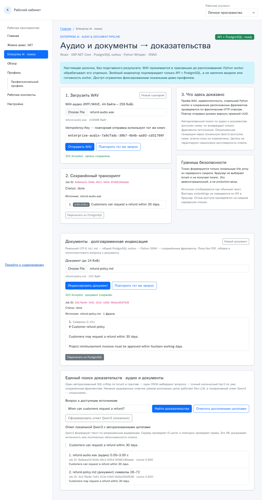

# EP-05b — локальный Qwen3:8b поверх текущих PostgreSQL-грантов

**Дата:** 2026-11-09. **Исходный main SHA:** `75477f11c28d65cb9aa88ec3d7ccaa15642ea3f2`. **Границы:** localhost demo, изолированная disposable PostgreSQL 16, строго синтетические WAV + Markdown; не production IAM, не публичная LLM API.

**Результат:** отдельная кнопка **«Сформировать ответ Qwen3 (локально)»** использует действующий `POST /enterprise-search/answer` с `mode:"generated"`; без `mode` сохраняется неизменённый EP-05 дословный ответ. Токен tenant/subject подписан доверенным Vite proxy, исходные права проверяются в SQL **до** отбора текста для модели. После генерации сервер **заново** проверяет, что *все* использованные источники по-прежнему принадлежат текущему tenant/subject и имеют грант. Потеря гранта → ответ модели и цитаты не возвращаются. Это новая проверка текущих прав, но **не абсолютная гарантия против гонки после финальной SQL-транзакции**.

[**Реальное Chromium E2E-видео (MP4)**](media/enterprise-generated-real.mp4) · [**Скриншот Qwen3 и источников**](media/enterprise-generated-real.png).



## Фактически проверенный стек

- React/TypeScript → подписанный локальный Vite proxy → ASP.NET Core Jobs API → PostgreSQL 16 jobs/outbox/grants → Python worker; WAV → **faster-whisper tiny.en** (настоящая модель), Markdown → **BGE-small EN v1.5 ONNX** (настоящая модель). Готовые job statuses — `done`.
- В одном запросе по WAV + Markdown точный косинусный авторизованный поиск дал две цитаты. Соседнее нерелевантное предложение про подтверждение счетов не попало в контекст Qwen3: перед вызовом модели используется существующий extractive sentence selector.
- Настоящий локальный **Ollama v0.40.15, `qwen3:8b` (Q4_K_M, 5,2 ГБ)** ответил: **“Customers can request a refund within 30 days.”** с авторизованными источниками `refund-audio.wav` и `refund-policy.md` (Job UUID / таймкод `0.00–3.00` c / позиции символов `26–72` видны в снимке). Ответ **не подменялся** HTTP-моком.
- **Playwright real-model E2E: 1/1 PASS** (первый проход — 119 с, второй проход — **49,9 с**, третий после полного перезапуска Vite и исправления старой подписи — **55,3 с** на весь сценарий с загрузками, ASR, embeddings, поиском, генерацией и проверкой отзывов). Итоговый записанный MP4 — **54,20 с, 315 395 байт**. **Это не latency одного LLM-запроса или воспроизводимое SLO**.
- **67/67 Python/PostgreSQL тестов PASS** после независимого ревью и исправления P2: два разных фрагмента из одного разрешённого job корректно проходят финальную SQL-проверку. Это дополнительно проверено через реальную PostgreSQL с двумя сохранёнными сегментами и двумя цитатами. **13/13 браузерных контрактных тестов** прошли в финальной регрессии, включая прежний Hiring Demo, EP-05 exact quote и новые генеративные состояния. Launcher 5/5, signer 2/2, TypeScript/Vite и .NET сборка PASS. Reviewer Codex не запускал собственные pytest, а выявил дефект статическим анализом. Отдельно проверялись: wrong tenant, wrong subject, no source → **не отправлять запрос Ollama**; expired/forged identity → 401; браузер не может подставить tenant, citations или model → 422; неправильный JSON, дубликаты ключей, неразрешённые ID, неполное завершение Ollama и surrogate Unicode → `abstained=true`; revoke во время инференции → `authorization_changed` без источников; Ollama offline/overload → 503, но обычный extractive режим работает.

## Контракт и ограничения

```http
POST /enterprise-search/answer
Authorization: Bearer <signed local demo token>
Content-Type: application/json

{"question":"When can customers request a refund?","top_k":5,"mode":"generated"}
```

Ответ возвращает `mode:"generated"`, `model:"qwen3:8b"`, `semantic_verified:false`, `abstained`, `reason`, `answer` и **только серверные** `citations` с job ID, именем источника, точным `quote`, time/character location. Отсутствие `mode` оставляет extractive `mode:"evidence"`. Клиент **не может** указать модель, URL, системный prompt или цитаты.

В Python `architecture/guarded_generation.py` Ollama запрашивается только по фиксированному **`http://127.0.0.1:11434/api/chat`**, с `trust_env=False`, отключёнными redirects, `think=false`, `num_ctx=2048`, `num_predict=192`, `temperature=0`, **одной** параллельной инференцией, 95-секундным HTTP-таймаутом, 12 KiB лимитом request и 32 KiB ограничением response. Ограничение потоков `num_thread=4` полезно для загруженного RDC. Промпт содержит только **до двух** SQL-authorized точных цитат, без векторов, закрытых источников, DB DSN или токена. Ответ модели JSON Schema строго валидируется; ID вида `E1`/`E2` преобразуются в исходные серверные job citations только после проверки. Для внешних эффектов/инструментов у модели полномочий нет.

**Существенное ограничение:** валидные ID и исходные цитаты **не доказывают**, что свободный текст модели семантически следует из них. Prompt injection не считается полностью решённым; источники изолированы как данные, сетевой Ollama локальный, tools запрещены, но генеративная модель может создать неверное утверждение с правильным ID. Для независимой верности нужен отдельный размеченный корпус и external/human evaluation. Никаких заявлений «hallucination-free», production OIDC/RLS, p95/SLO или непрерывной доступности Ollama.

## Как повторить

1. Установить `qwen3:8b` в локальный Ollama, **без загрузки моделей в CI по умолчанию**. Запустить Ollama с `OLLAMA_HOST=127.0.0.1:11434`. `ollama list` должен показывать `qwen3:8b`.
2. Создать **новую disposable** PostgreSQL `reliable_jobs`, применить `dotnet-outbox/sql/001_init.sql` … `005_document_jobs.sql`. Не использовать работающую БД других проектов.
3. Подготовить `ConnectionStrings__Jobs`, `JOBS_TEST_CONNECTION` (одна и та же disposable DB), общий `DEMO_AUTH_SECRET` не короче 32 байт, `HF_HOME`, Python зависимости `architecture/audio-requirements.txt`. В первом терминале выполнить `python enterprise-demo/run.py`; серверу Ollama не требуется участие в launcher. Без Ollama поиск и дословный ответ продолжают работать.
4. Для real-model Chromium E2E задать синтетический WAV `/tmp/ep05b-refund-sample.wav`, например через ffmpeg Flite: `flite=text='Customers can request a refund within thirty days':voice=slt`, PCM 16kHz mono, затем:

```bash
cd bootstrap5
LIVE_ENTERPRISE_SEARCH=true LIVE_ENTERPRISE_GENERATION=true \
EP04_WAV_PATH=/tmp/ep05b-refund-sample.wav \
EP04_TEST_PYTHON=/path/to/python-with-psycopg \
PLAYWRIGHT_BROWSERS_PATH=/ms-playwright \
npx playwright test tests/enterprise-search-live.spec.ts --workers=1
```

**Важно:** `LIVE_ENTERPRISE_GENERATION` не включён в обычные GitHub Actions: он требует настоящих ML-весов, достаточной RAM и explicit disposable DB. CI исполняет unit, реальные PG и mock browser contract tests, но **не** считает их заменой этого отдельного опт-ин модельного прогона.

**Задачи после EP-05b:** независимые quality/faithfulness benchmarks, калибровка retrieval threshold 0.67 и LLM output; затем durable fault drill/ранее наблюдавшийся .NET OOM. LangGraph/MCP tool-planner, cloud IAM/масштабирование **не реализованы**.
