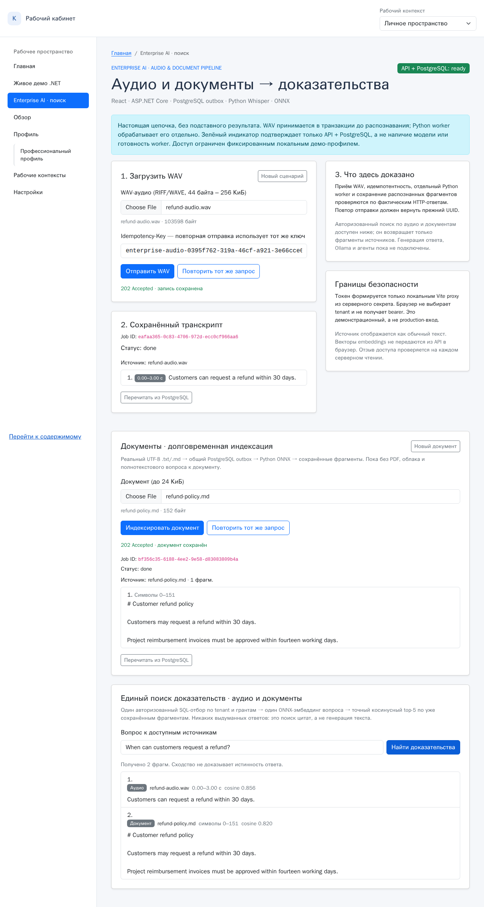

# EP-04: единый авторизованный поиск по аудио и документам — 9 ноября 2026

**Исходный SHA `main`:** `a9f21fc0a5dc46dbb8ae9f29b0810dfa1b95534c`. Исполнение до коммита EP-04 проведено в изолированном worktree `feature/ep04-unified-search`, с настоящими локальными моделями и *одноразовой* PostgreSQL 16 (миграции 001–005). Данные полностью **синтетические**. Не утверждать production-ready или подтверждённую точность релевантности на реальных документах.

[Смотреть настоящую запись Chromium (MP4, 18,8 с)](media/enterprise-search-real.mp4) · [Полный скриншот результатов](media/enterprise-search-real.png)



## Что фактически проверено

1. Через **одну React-страницу** загружен настоящий WAV размером **103 598 байт**, созданный FFmpeg/Flite из синтетической английской фразы. `.NET /audio-jobs` сохранил задачу в `jobs/outbox`, отдельный Python worker распознал аудио `faster-whisper tiny.en`, создал таймкодированный транскрипт и локальный 384-мерный ONNX-вектор BGE-small.
2. Через `/document-jobs` аналогично принят `refund-policy.md` (152 байта), индексирован **тем же worker**, сохранивший исходный текст, координаты и модель `BAAI/bge-small-en-v1.5`.
3. Браузер отправил `POST /enterprise-search/search` с вопросом *“When can customers request a refund?”*; доверенный локальный Vite proxy добавил короткий HMAC-токен фиксированного демо-пользователя. Независимый Python HTTP search adapter сделал **единственный SQL-грант-отбор** по `tenant_id` и действующему `audio_read_grants`, сформировал **один эмбеддинг вопроса** и выполнил точное косинусное ранжирование по *уже сохранённым* документным и аудиофрагментам.
4. В настоящем Chromium на снимке видны **оба** результата (не заглушки): `refund-audio.wav`, `0,00–3,00 с`, cosine **0,856**; `refund-policy.md`, символы `0–151`, cosine **0,820**. Это значения только **одного синтетического запроса**, а не оценка качества поиска или сравнение алгоритмов.
5. Прямой запрос к Python API **без токена → HTTP 401**. Корректный подписанный токен **другого tenant → пустая выдача**. После удаления гранта документа следующий запрос вернул **только аудио**; после удаления гранта аудио — `hits=[]`, `abstained=true`, и браузер сообщил *«Нет доступных доказательств»*. Никакие чужие фрагменты или vectors в HTTP-ответ не попадали.
6. **19,0 с** — время *всего* Playwright-теста, включая обе загрузки, ожидание индексации, запросы, проверки прав и UI, **не время одного семантического поиска и не обещание производительности**.

## Дополнительные проверки

- **31/31 Python + реальных PostgreSQL тестов PASS** в заключительной изолированной регрессии без фонового worker, включая поиск двух типов источников, `top_k`, фильтрацию по tenant/subject и немедленный отзыв, пропуск повреждённых/несовместимых векторов, отказ без запуска модели при отсутствии разрешённого или совместимого контента, обработку повторов аудио и документов. На первом прогоне при ошибочно работающем фоне упали четыре конкурентных fault-теста; после остановки фонового worker они прошли без изменения тестируемой логики.
- **7/7 тестов EP-04 (unit/API)** PASS, без дополнительных серверов/моделей. Независимое ревью Codex CLI обнаружило лишнюю инициализацию модели при наличии только несовместимых источников; устранено предварительным фильтром model provenance, добавлен PostgreSQL-тест `test_incompatible_only_corpus_abstains_without_model_loading`, после чего все 31 проверки прошли.
- **2/2 новых Chromium-stub теста** проверяют отображение двух видов фрагментов, `abstained` и очистку предыдущих данных при HTTP-ошибке.
- Отдельный реальный [EP-02 WAV→Whisper](EVIDENCE-2026-11-08.md) и [EP-03 Markdown→ONNX](EVIDENCE-2026-11-09.md) уже проверены, код перенесён без второго хранилища/очереди/ACL.
- Модуль `/ready` подтверждает только доступность **PostgreSQL**, но не готовность/качество ONNX или Whisper. Отсутствие грантов не вызывает инициализацию модели и не возвращает даже названия источников.

## Как воспроизвести

1. Использовать **только disposable PostgreSQL `reliable_jobs`**, применить миграции `001`–`005` по порядку. На RDC с удалённым Docker файлы миграций из RDC передавать через `docker exec -i ... psql < ...`; не использовать `-v` с путём, отсутствующим у Docker-хоста. БД ChatPilot/KnowledgePilot не трогать.
2. Задать в окружении процесса `ConnectionStrings__Jobs` (Npgsql) и `JOBS_TEST_CONNECTION` (libpq) к **одной** disposable базе, сгенерировать `DEMO_AUTH_SECRET` минимум 32 байта (не хранить в git или браузере), установить зависимости `architecture/audio-requirements.txt` в отдельное окружение, подготовить локальный модельный кэш и свободную RAM.
3. Запустить `python enterprise-demo/run.py`. Он поднимет .NET на `127.0.0.1:5077`, Python worker, search API `127.0.0.1:5088` и Vite `127.0.0.1:4173`. Убивает только свои дочерние процессы; миграции не применяет.
4. Создать малый оригинальный WAV:

```bash
ffmpeg -y -f lavfi -i "flite=text='Customers can request a refund within thirty days':voice=slt" \
  -ar 16000 -ac 1 -c:a pcm_s16le /tmp/ep04-refund-audio.wav
```

5. В другом терминале с теми же изолированными DSN, ключом и тестовым Python:

```bash
cd bootstrap5
LIVE_ENTERPRISE_SEARCH=true \
EP04_WAV_PATH=/tmp/ep04-refund-audio.wav \
EP04_TEST_PYTHON=/path/to/python-with-psycopg \
npx playwright test tests/enterprise-search-live.spec.ts --workers=1
```

Тест выполняет **административный отзыв грантов внутри одноразовой БД**; не запускать на чужих/production данных. По умолчанию модельный E2E пропускается (опт-ин), обычный CI проверяет статический контракт и PostgreSQL с fake-query encoder без загрузки больших моделей.

## Честные ограничения и следующий этап

Это **exact cosine retrieval**, а не генерация ответа, no-evidence = отказ только при отсутствии доступных/совместимых фрагментов; **не доказано**, что каждый возвращённый фрагмент семантически отвечает вопросу. Нет оценки качества на независимом корпусе, нет OIDC/RLS (используется фиксированный *localhost-only* демонстрационный principal), нет изоляции разных пользователей внутри одного браузерного Vite-сервера, глобальный `Idempotency-Key` старой схемы не tenant-scoped. Прототип ограничен 100 новейшими доступными job, 500 фрагментами и `top_k<=5`; большие документы и версии вне scope. Длительный soak/RAM надёжности пока не подтверждён; в предыдущем EP-02 был наблюдаемый, но не объяснённый поздний `.NET Out of memory` под высокой нагрузкой RDC.

**EP-05:** приёмка evidence-only ответа и проверка, что отсутствие достаточных доказательств не приводит к ложному утверждению. Подключать LLM/агентов только после надёжной матрицы отказов и проверки цитирования.
