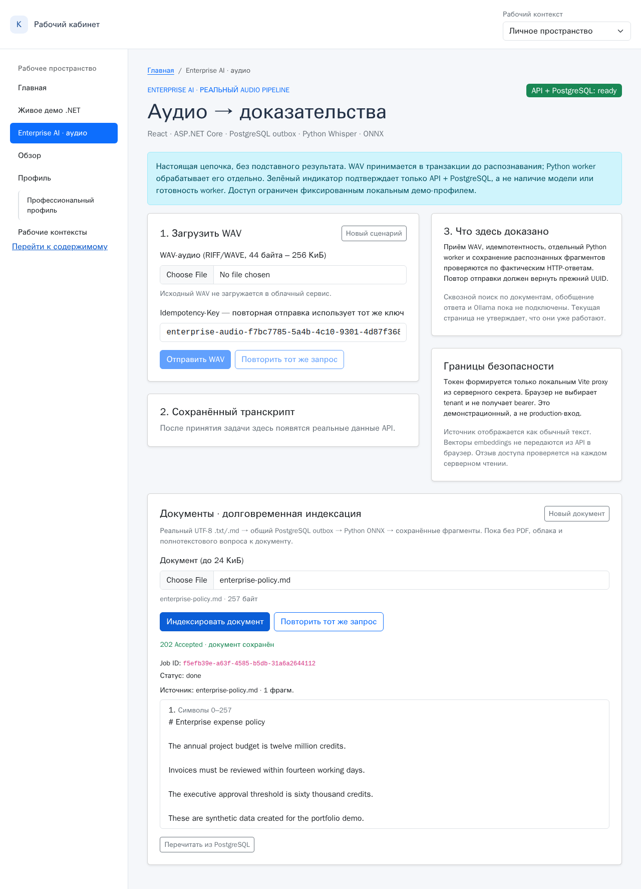

# EP-03 — проверка долговременной индексации документов, 9 ноября 2026 года

**Базовая ревизия:** `main` @ `d660f5dcd1b300371bafd3ee6f3857ad8bd13928`. Изменения EP-03 и opt-in тесты добавлены поверх неё. Доказана работа **малого локального .txt/.md сценария**; это не production-IAM, не готовый объединённый RAG и не тест большой нагрузки.

## Настоящий запуск без имитации модели или HTTP

[Видео настоящего Chromium-сеанса (MP4)](media/enterprise-document-live.mp4) · [Скриншот индексации](media/enterprise-document-live.png)



На `rdc-project` в изолированной PostgreSQL 16 (временный контейнер с `tmpfs`; база `reliable_jobs`, миграции **001→005**) и при настоящих .NET 10, React, Python FastEmbed/ONNX:

- Пользователь загрузил синтетический `enterprise-policy.md` (UTF-8, 257 байт), не касающийся работодателей. API вернул **202 Accepted** до выполнения эмбеддинга.
- Существующий `jobs` + `outbox`, **без новой очереди**: `kind=document`, текст/имя и грант владельца сохранены в одной транзакции. Тот же Python worker, который обрабатывает WAV, получил задачу через SQL lease, закодировал документ и записал исходные фрагменты с индексом и диапазоном символов.
- После индексации `jobs.status=done`, `outbox.attempts=0`, `processed_at` заполнено; эмбеддинг документа — **384 координаты**, совместимый с используемой для аудио моделью **BAAI/bge-small-en-v1.5**.
- Авторизованный ответ `GET /jobs/{id}` содержит исходный текст, имя документа и координаты символов, **но не embeddings**. Это же правило теперь действует для аудио.
- Один и тот же Idempotency-Key и документ возвращают **200 already-accepted** и прежний UUID; другое содержание под тем же ключом — **409 Conflict**.
- Неавторизованный запрос и запрос с корректным токеном **другого tenant** получают **404**. Доверенное административное удаление гранта немедленно превращает следующий запрос в 404 и очищает отображённый документ.
- **Реальный Chromium Playwright E2E: PASS**; проверка после добавления сценария конфликта ключей и wrong-tenant заняла **3,6 с** (прогретая модель). Эти цифры — длительности отдельных тестов, **не benchmark производительности**.
- **13/13** реальных PostgreSQL-тестов для документов, аудио и ACL — PASS, включая два новых теста документа с атомарным завершением и повтором после ошибки; ранее подтверждённые lease/reclaim/fencing аудио сохранены.
- **Проверка регрессии аудио:** оригинальный реальный WAV→Whisper браузерный E2E снова PASS (11,0 с) на схеме после миграции 005. Старый текстовый Hiring Demo не изменён.
- Два новых браузерных HTTP-stub теста — PASS; TypeScript и .NET сборка — PASS.

Видео показывает реальное состояние UI, без предзаполненного ответа. Все данные синтетические; результаты не означают качество поиска по реальным документам. Отдельный поздний API Out-of-memory на загруженном RDC в предыдущей серии испытаний [остаётся неразобранным](EVIDENCE-2026-11-08.md).

## Воспроизведение

1. На **изолированной** БД применить `dotnet-outbox/sql/001_init.sql` → `005_document_jobs.sql` по порядку. В RDC с удалённым Docker пути для `-v` не должны указывать на несуществующие пути Docker-хоста — передавайте SQL через `docker exec -i ... psql < file.sql`. Не использовать БД ChatPilot/KnowledgePilot.
2. Задать `ConnectionStrings__Jobs` (Npgsql), `JOBS_TEST_CONNECTION` (libpq), `DEMO_AUTH_SECRET` (секрет минимум 32 байта) **только в терминальном окружении**. На RDC соединение с PostgreSQL, опубликованной Docker-хостом на `55432`, использует `host.docker.internal`.
3. Запустить `python enterprise-demo/run.py` в виртуальном окружении с `psycopg`, `faster-whisper`, `fastembed` и готовыми локальными моделями. Launcher не ставит пакеты и не загружает модели самостоятельно; библиотеки могут скачать их при первом обращении.
4. Для реального теста, не мокая HTTP, выполнить:

```bash
cd bootstrap5
LIVE_ENTERPRISE_DOCS=true EP03_TEST_PYTHON=/path/to/python-with-psycopg \
npx playwright test tests/enterprise-documents-live.spec.ts --workers=1
```

`JOBS_TEST_CONNECTION` у теста должна быть от **одноразовой тестовой БД**. Скрипт вызывает доверенную Python-функцию `revoke_read` — это административное изменение тестового гранта, не браузерный HTTP-метод. Обычные CI не запускают модельный тест без флага.

Для проверки SQL lease и повторов после ошибок, пока фоновый worker остановлен:

```bash
python -m pytest -q architecture/tests/test_documents_postgres.py architecture/tests/test_audio_postgres.py architecture/tests/test_audio_access.py
```

**Границы EP-03:** текст `.md/.txt` до 24 КиБ, без PDF/OCR; вложения передаются как JSON-текст; нет хранения исторических версий, общего поиска или ответов на вопросы. Поиск **EP-04** должен авторизовать tenant и субъект **в PostgreSQL до ранжирования**, не выдавать векторы и не смешивать эмбеддинги разных моделей. Название таблицы `audio_read_grants` историческое, но это **единая** таблица прав для audio и document; рефакторинг названия возможен отдельно без двойного хранения. Идемпотентность по-прежнему использует глобальный `idempotency_key`, поэтому её tenant-scoped эволюция требует отдельной миграции и проверки совместимости со старым Hiring Demo.
