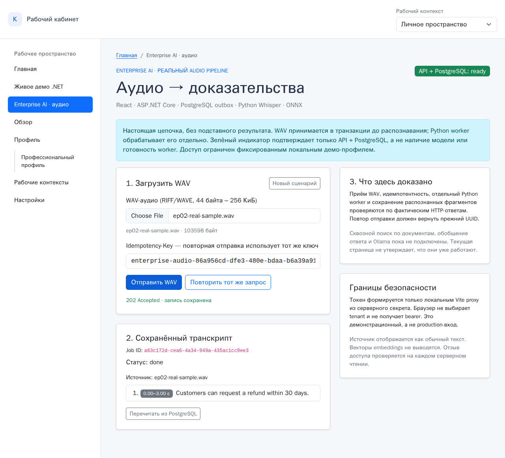

# Enterprise AI — WAV → durable job → Whisper → timestamped transcript

**Status:** first EP-02 live model-backed browser route **verified 2026-11-08** on disposable PostgreSQL; longer-running resource reliability and production IAM are not established. Unlike the existing text [Hiring Demo](../hiring-demo/README.md), this page connects to the *real audio* endpoint and a separately running Python worker. See the [acceptance evidence with screenshot and real screencast](EVIDENCE-2026-11-08.md).

[](EVIDENCE-2026-11-08.md)

[Watch the recorded real browser run (MP4)](media/enterprise-ai-real-whisper.mp4)

## User journey

Open `http://127.0.0.1:4173/dashboard/enterprise-ai`. Choose a **small local WAV** (44–262,144 bytes), submit it and observe an actual `202 Accepted` and UUID. A separately running Python worker takes the job from PostgreSQL, runs local Whisper/ONNX inference and stores a timestamped transcript. The page polls the real `GET /jobs/{id}`, showing `queued`, `done` or `failed`; no "processing" state is invented. Repeating the same file and key should return `200 already-accepted` with the **same UUID**. The UI discards embedding vectors from the response. **Known limitation:** the existing `GET /jobs/{id}` still serializes authorized audio embeddings to the browser over HTTP; a narrower API-side transcript projection is needed before production use or larger documents.

**Security boundary:** The browser connects only to the localhost Vite `/enterprise-api` reverse proxy; it **does not** receive or generate the bearer token. On every proxied request Vite creates a 5-minute HMAC-signed demo identity for the *fixed* `tenant=demo-team, sub=interviewer` using the server-side `DEMO_AUTH_SECRET`, overwriting any browser-supplied Authorization. If secret is missing/short, the enterprise proxy fails with 503. This grants **every browser able to reach the Vite server** the same fixed demo identity: use on **trusted localhost only**, never expose it or use with real sensitive data. This is **not login, OIDC or per-user production authorization**. The existing `/demo-api` proxy remains unchanged.

## Prerequisites

- A disposable `reliable_jobs` PostgreSQL database, with all four migrations `dotnet-outbox/sql/001_init.sql` → `004_audio_acl.sql`. Compose initializes **only 001 on a new volume**. The launcher checks schema read-only and **never** creates, alters or drops a DB.
- .NET 10 SDK; Node version supported by `bootstrap5/package.json`; Python with dependencies from `architecture/audio-requirements.txt`. Real inference also needs FFmpeg and cached `faster-whisper` + `fastembed` weights. The launcher never installs dependencies or downloads weights itself; **the underlying inference libraries may download model weights on first processing if they are not already cached**, so pre-warm/cache them deliberately if disk or networking is restricted.
- A secret of at least 32 UTF-8 bytes, shared by API and Vite. Set it **in the terminal**, not in `.env` committed files or any `VITE_*` frontend variable.

### One-time isolated DB setup (manual)

At the repo root, on the machine that has Docker:

```bash
docker compose -p demo-outbox -f dotnet-outbox/compose.yaml up -d --wait
# Use this only on the isolated demo DB; 001 is initialized by Compose for NEW volumes.
for migration in 002_audio_jobs.sql 003_audio_leases.sql 004_audio_acl.sql; do
  docker exec -i demo-outbox-postgres-1 psql -v ON_ERROR_STOP=1 -U demo -d reliable_jobs < "dotnet-outbox/sql/$migration"
done
```

Running the migrations again on a pre-existing demo DB is safe if they were already applied. Do **not** send these commands to ChatPilot, AccountManager or another developer database. Check available free disk space before `docker`, `npm ci`, or model downloads.

### Dependencies and start

From the repository root on a machine that can reach the disposable PostgreSQL container:

```bash
python3 -m pip install -r architecture/audio-requirements.txt
cd bootstrap5 && npm ci && cd ..
export ConnectionStrings__Jobs='Host=127.0.0.1;Port=55432;Database=reliable_jobs;Username=demo;Password=demo'
export JOBS_TEST_CONNECTION='host=127.0.0.1 port=55432 dbname=reliable_jobs user=demo password=demo'
export DEMO_AUTH_SECRET="$(python3 -c 'import secrets; print(secrets.token_urlsafe(48))')"
python3 enterprise-demo/run.py
```

**RDC/network variant:** If PostgreSQL is reachable inside the trusted `knowledge-pilot-dev` Docker network, change the host in both DSNs to `demo-outbox-postgres` and port to `5432`. .NET needs **Npgsql semicolon syntax**; Python `psycopg` needs **libpq space-separated syntax**. Set the same secret in the single launcher environment (its children inherit it). Do not print or record the secret.

The launcher starts and supervises exactly **its own** .NET API (`127.0.0.1:5077`), Python audio worker and Vite (`127.0.0.1:4173`) and terminates its child process groups on exit. It fails for missing dependencies, mismatched DB schema, blocked ports, or dead children. **`/ready` only proves .NET + PostgreSQL**, not worker/model readiness. A real finished job proves that the worker processed *that* job.

### Produce a new, not preprocessed, WAV

If FFmpeg was built with the `flite` lavfi filter, synthesize a short reproducible original sample:

```bash
ffmpeg -y -f lavfi -i "flite=text='Customers can request a refund within thirty days':voice=slt" \
  -ar 16000 -ac 1 -c:a pcm_s16le /tmp/enterprise-sample.wav
stat -c '%s bytes' /tmp/enterprise-sample.wav   # must be 44..262144
```

Select the resulting WAV in the browser; do not pre-run the worker on it. The first inference may cause faster-whisper/fastembed to download missing model weights; review cache, disk space and network access before submitting. CPU inference may take time. No vendor API or cloud credential is required. If local model weights are missing and downloading is not acceptable, the UI can demonstrate actual durable acceptance, but **not** claim completed inference.

## Local verification (separate evidence levels)

```bash
node --test bootstrap5/tests/enterprise-auth.test.mjs       # signed identity contract, no DB
python3 -m unittest discover -s enterprise-demo/tests -v # launcher static tests, no DB
python3 -m py_compile enterprise-demo/run.py                # syntax
cd bootstrap5 && npm run check && npm run check:e2e       # TypeScript
npx playwright test tests/enterprise-ai.spec.ts            # stubbed browser contract ONLY
```

### Initial source/contract verification — 2026-11-08 (before model-backed acceptance)

On `rdc-project` from an isolated worktree based on `main` @ `5e0192ab39954435580c490dfcd08a139df3b24e`:

- **PASS:** `npm run check`, `npm run check:e2e`, `npm run build`, targeted ESLint of `EnterpriseAiPage.tsx`.
- **PASS:** 2 Chromium browser-contract tests for the new page (HTTP stubs, including retry and revoked 404); 1 original Hiring Demo browser-contract regression test.
- **PASS:** 5 Python launcher/cross-language token tests, 2 Node signer tests, `py_compile`, and `git diff --check`.
- **PASS:** standalone real Vite proxy without `DEMO_AUTH_SECRET` returned HTTP **503** on `/enterprise-api/ready`.
- **Known baseline:** broad `npm run lint` fails on existing `HiringDemoPage.tsx:57` with `react-hooks/set-state-in-effect`, which predated this slice. New page passes targeted ESLint.
- **Not performed in the initial coding step:** live browser→PostgreSQL→Whisper because system Python lacked `psycopg`, `faster_whisper`, `fastembed`. A separate pre-existing Python virtual environment with these dependencies was later located and reused.

### Actual model-backed acceptance and limits

**Two successful real browser/Whisper runs**, eight passing PostgreSQL worker resilience tests, saved [video/screenshot](EVIDENCE-2026-11-08.md), including idempotency and revocation after genuine inference. These demonstrate the *bounded local WAV slice* and do not prove workload scalability, general speech accuracy, uptime or production readiness. A later third browser attempt encountered an .NET `Out of memory` exit after long-running high-pressure RDC operation; the launcher correctly reported service failure. See the full [evidence and reproduction instructions](EVIDENCE-2026-11-08.md) and [contract baseline](../architecture/enterprise-platform/contracts.md). The later document ingestion, unified authorized search, evidence-only answers and local LLM remain **EP-03–EP-06 future work**.
